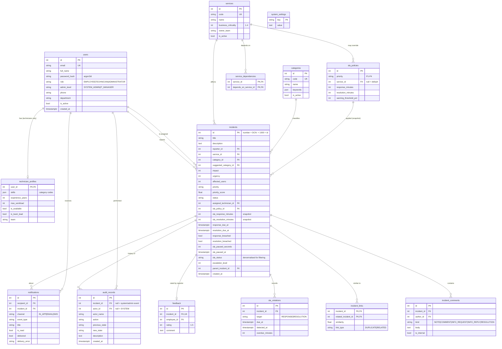

# Database design (PostgreSQL 18)

Schema source: `backend/app/repositories/orm.py`; migrations: `backend/alembic/versions/`.
Only portable column types are used (JSON, timestamptz, …), so the same schema runs on SQLite for tests.

## Important constraints and indexes

| Rule | Enforced by |
|---|---|
| One account per email | `users.email` unique |
| One SLA policy per (priority, service) | `uq_sla_priority_service` |
| Each SLA target violated at most once per incident | `uq_violation_incident_target` + `SLATracker` check |
| One feedback per incident | `feedback.incident_id` unique |
| Service dependency graph is acyclic | `AdminService._reject_cycles` (depth-first search) |
| Fast queue/search/dashboards | indexes on `(status, priority)`, `(service_id, created_at)`, `sla_status`, `assigned_technician_id`, `reporter_id`, `created_at`; notifications `(recipient_id, is_read)` |

## Design notes

- **Domain model ≠ table model.** Mappers in `repositories/mappers.py` translate between them, so the domain stays
  framework-free.
- **SLA clock stored inline** in `incidents` (composition: it has no identity of its own). Policy targets are
  snapshotted, so editing a policy never silently moves existing deadlines.
- **Users: single table + optional profile** for the Employee / Technician / Administrator inheritance. Technician-only
  data lives in `technician_profiles` (1:0..1).
- **Audit is append-only**: rows are only inserted (by the `AuditLogger` observer), never updated.

## Sample data

`python -m scripts.seed --reset` creates 18 users, 11 services with dependencies, 9 categories, 7 SLA policies
(4 defaults + 3 service overrides) and 43 incidents in every lifecycle state (except the transient NEW). The data
includes SLA violations, near-duplicate links, escalations, feedback and a deliberately unassigned incident, all generated
by replaying history through the real services. See `docs/SETUP.md` for the credentials.
