# Decerno: Intelligent IT Service Management & Incident Resolution System

**Project report: CS F213 Object-Oriented Programming, Semester I 2026-2027**

*Decerno is our implementation of the I-ITSM system described in the project specification. The name is Latin:
decernō, "I decide, I settle".*

| | |
|---|---|
| Group | **[Group No.]** |
| Members | **[Member 1 name, ID]**, **[Member 2 name, ID]**, **[Member 3 name, ID]** |
| Repository | <https://github.com/adi-rajauria/OopsProject> |
| Demo video | `[Group No.]_OOP_S1_2025-2026_Project` |
| Date | 22 November 2026 |

### At a glance

| | |
|---|---|
| What it is | A full-stack web application for the complete IT incident lifecycle, built around a pure object-oriented domain model |
| Users | Employee, Technician (incl. team lead), Administrator (System Admin, IT Manager), each with its own interface |
| Intelligence | **13** explainable intelligent / automated features (the spec asks for 2), plus a *Why Decerno decided* card on every incident |
| Design | **7** design patterns, layered architecture, the domain has no framework imports |
| API | **73** REST operations + a Server-Sent Events stream, documented automatically (Swagger UI) |
| Data | PostgreSQL 18, **14** tables, migrations with Alembic, a realistic seed of 43 incidents |
| Quality | **178** automated test cases on SQLite and PostgreSQL, CI on every push, 107 documented test cases |
| Size | backend ~7,500 lines (88 files), frontend ~5,200 lines (42 files), tests ~1,800 lines, docs ~2,300 lines |
| Innovation | voice input, real-time dashboard, service dependency graph with root-cause hints, predictive SLA risk, CI/CD |

---

## Contents

1. [Problem analysis](#1-problem-analysis)
2. [Requirements specification](#2-requirements-specification)
3. [System architecture](#3-system-architecture)
4. [UML diagrams](#4-uml-diagrams)
5. [Object-oriented design](#5-object-oriented-design)
6. [Intelligent features](#6-intelligent-features)
7. [User interface and experience](#7-user-interface-and-experience)
8. [API design](#8-api-design)
9. [Technology stack](#9-technology-stack)
10. [Technology selection report](#10-technology-selection-report)
11. [Database design](#11-database-design)
12. [Exception and error handling](#12-exception-and-error-handling)
13. [Security](#13-security)
14. [Testing](#14-testing)
15. [Development process](#15-development-process)
16. [Scalability and future evolution](#16-scalability-and-future-evolution)
17. [Known limitations](#17-known-limitations)
18. [Team and responsibilities](#18-team-and-responsibilities)
19. [Conclusion](#19-conclusion)

Appendix A: [Spec coverage checklist](#appendix-a-spec-coverage-checklist) ? Appendix B: [How to run](#appendix-b-how-to-run) ? Appendix C: [Demo accounts](#appendix-c-demo-accounts)

---

## 1. Problem analysis

### 1.1 The problem

An organisation with hundreds of employees depends on many IT services: payments, e-mail, single sign-on, VPN,
databases, cloud storage. When one of them fails, someone has to notice, report it, decide how serious it is, find the
right person to fix it, keep track of deadlines, tell everyone affected what is happening, and keep a record of it all.

Done by hand (e-mail threads, spreadsheets, phone calls), this breaks down as volume grows. The specification lists the
typical symptoms, and each of them has a concrete cause:

| Symptom | Underlying cause |
|---|---|
| Delayed response | Nobody is clearly responsible; reports sit in a shared inbox |
| Incorrect prioritisation | Priority depends on who shouts loudest, not on business impact |
| Inefficient technician allocation | Work goes to whoever is known, not whoever is skilled and free |
| SLA violations | Deadlines are not computed, so nobody sees one approaching |
| Poor visibility into service health | No aggregated view across services and their dependencies |
| Duplicate incident reports | Ten people report the same outage, ten people work on it |
| Incomplete incident history | Decisions and actions are not recorded |
| Recurring problems not identified | Nobody connects this week's VPN drop-out with last week's |

### 1.2 Stakeholders

| Stakeholder | Interest | How Decerno serves them |
|---|---|---|
| **Employees / customers** | Get their problem fixed quickly and know what is happening | Simple report form (typed or spoken), live status, a timeline, fixes to try first, notifications |
| **Technicians / support engineers** | A clear queue, the information they need, no busywork | Personal queue sorted by deadline, internal notes, "request info" that pauses the SLA, suggested fixes from history |
| **Team leads** | Their team's critical work does not slip | Automatic escalation to them when a P1 is not acknowledged |
| **System administrators** | Configure and run the service desk | Manage users, technicians, services, categories, SLA policies and the assignment strategy |
| **IT manager** | Service health and SLA performance | Dashboards, SLA compliance report, service health with correlation, last level of escalation |
| **Auditors / management** | Accountability | Append-only audit trail of every action, with actor, time and state change |

### 1.3 Existing challenges

- **Volume:** hundreds of incidents per day cannot be triaged by reading each one.
- **Consistency:** two people given the same report choose different priorities.
- **Knowledge silos:** the fix for a recurring problem lives in one technician's memory.
- **Change:** the organisation adds services, categories and policies, and changes how it assigns work. A rigid system
  needs code changes for every one of these.

### 1.4 Proposed solution

**Decerno** (Latin *decernō*, "I decide, I settle") is a full-stack web application. The name reflects what it does:
it **decides** priority, the applicable SLA, the technician and when to escalate, and it helps **settle** (resolve)
every incident. It manages the complete lifecycle
**Report → Classify → Prioritise → Assign → Investigate → Resolve → Verify → Close**, with:

- a **rule-based, documented priority formula** (impact × urgency × business criticality × affected-users factor);
- **four interchangeable assignment strategies** that an administrator can switch at runtime;
- **SLA deadlines** per priority and per service, warnings at 75 %, violation recording, and a background monitor;
- an **enforced lifecycle** in which illegal transitions (e.g. NEW → CLOSED) are impossible;
- **notifications** on three channels (in-app, simulated e-mail, simulated SMS) and a **real-time dashboard**;
- a **complete audit trail**;
- **search with 11 criteria**, dashboards and CSV export;
- **thirteen intelligent / automated features**, all explainable (the spec asks for two).

The central design idea is that the business rules live in a **pure object-oriented domain model** with no framework
code in it. Everything that varies (priority calculation, assignment, notification channels, persistence, text
similarity) sits behind an interface, so it can be changed without touching the rest of the system.

### 1.5 Assumptions

All 99 assumptions are numbered in [`docs/ASSUMPTIONS.md`](ASSUMPTIONS.md). The ones that shape the design most:

1. **Three roles**, modelled by inheritance: `Employee`, `Technician`, `Administrator`. "Team lead" is a technician flag
   and "System admin" / "IT manager" are administrator levels, because they differ in data, not in behaviour.
2. **Self-registration always creates an Employee.** Only administrators create technicians and administrators.
3. **Business criticality belongs to the service** (1-4), set by the administrator, not chosen by the reporter.
4. **SLA clocks run 24 × 7** (no business hours) and **pause while the incident waits for the reporter** (PENDING_INFO).
5. **Only the reporter can verify a resolution.** An administrator may close an unverified resolution after 72 hours
   (audited as an override).
6. **Only a near-identical report from the same person within 30 minutes is blocked** as a duplicate (an accidental
   double submit). Similar reports from other people are linked, never blocked.
7. **E-mail and SMS are simulated** behind adapters; real providers can be plugged in without changing other code.
8. **Single process:** the SLA monitor and the live-update broadcaster run inside the API process (see Section 16).

### 1.6 What makes Decerno different

Most incident trackers are forms plus a status column. Decerno is built around **decisions**, which is what its name
means (*decernō*, "I decide"):

- **Every decision is explained.** Each incident page has a *Why Decerno decided* card that lists the category, the
  priority formula with the actual numbers, the SLA that applies, why this technician was chosen, which reports were
  linked and how similar they were, and the escalation chain. Nothing is a black box.
- **Help before the ticket exists.** While an employee types, Decerno suggests the category, the impact and urgency
  (with the phrase that triggered it), shows similar open incidents, and offers fixes that worked before. Some problems
  are solved without a ticket; the rest arrive better described.
- **Service-aware, not ticket-aware.** A dependency graph connects services, so Decerno can say "four payment
  incidents in two hours: one underlying problem" and "the API Gateway that Payments depends on also has incidents".
  It also notices problems that keep coming back over weeks.
- **Fair SLAs.** The clock pauses while the technician waits for the reporter, and every incident shows a predicted
  resolution time from comparable past incidents.
- **A feedback loop.** Reporters rate the fix; ratings feed back into technician recommendations.
- **Voice everywhere.** Incidents, notes, questions and resolutions can be dictated.
- **Its own identity:** the name, a "D holding a tick" logo, the Domine typeface, an indigo and gold palette, and
  incident numbers of the form `DCN-1001`.

---

## 2. Requirements specification

### 2.1 User roles

| Role | Can do |
|---|---|
| **Employee** | Register / sign in; report an incident (typing or voice); see live suggestions (category, impact / urgency, similar open incidents, fixes to try first); view own incidents and their timeline; answer technician questions; add information; view the resolution; verify with a 1-5 rating or reopen; receive notifications; export own incidents |
| **Technician** | Everything an employee can do, plus: view the personal queue; acknowledge; start work; add internal notes; request information; resolve with a summary; see suggested resolutions and the predicted resolution time; view workload, all incidents, service health |
| **Administrator** (System Admin, IT Manager) | Everything, plus: manage users and technicians (skills, team, workload cap, availability); manage IT services and their dependencies; configure SLA policies per priority and per service; configure categories and their keywords; switch the assignment strategy; enable P2 escalation; assign / reassign manually with recommendations; view dashboards, SLA report, audit log; run an SLA check on demand; export CSV |

### 2.2 Functional requirements

| ID | Requirement |
|---|---|
| FR-1 | Users register (employees) and sign in with e-mail and password; every request is authenticated with a token. |
| FR-2 | An employee reports an incident with title, description, affected service, impact (1-4), urgency (1-4), number of affected users and an optional category. |
| FR-3 | On creation the system classifies the incident (category chosen or suggested), calculates its priority, attaches the applicable SLA, checks for duplicates and related incidents, and assigns a technician with the active strategy. |
| FR-4 | Priority is P1-P4 from impact, urgency, the service's business criticality and the number of affected users. Editing impact or urgency recalculates the priority and the deadlines. |
| FR-5 | At least two assignment strategies (four implemented: skill, load, round-robin, experience); an administrator can switch them at runtime. Manual assignment respects workload caps. |
| FR-6 | The SLA module finds the applicable policy (service-specific, else default), computes response and resolution deadlines, warns at 75 %, records violations once each, and pauses while waiting for the reporter. |
| FR-7 | A background monitor checks every open incident every 60 seconds and escalates unacknowledged P1 incidents: Technician → Team Lead → System Admin → IT Manager. |
| FR-8 | The lifecycle NEW → CLASSIFIED → ASSIGNED → ACKNOWLEDGED → IN_PROGRESS (⇄ PENDING_INFO) → RESOLVED → VERIFIED → CLOSED is enforced; reopen and reassign are allowed; everything else is rejected. |
| FR-9 | Notifications for creation, classification, assignment, priority change, status changes, information requests, SLA warning, SLA violation, escalation, resolution and closure, on in-app, e-mail and SMS channels chosen per event. |
| FR-10 | Every action is audited with timestamp, user, action, incident, previous state, new state and description. |
| FR-11 | Search and filter by incident number, text, date range, status, priority, category, service, technician, unassigned, SLA status and open-only; sort and paginate; export to CSV. |
| FR-12 | Dashboards: incident overview, technician workload, service analysis (count and MTTR), SLA compliance and violations, trends, service health with dependency graph. |
| FR-13 | Intelligent features: duplicate / related detection, incident correlation, automatic escalation, smart technician recommendation, SLA risk detection, category suggestion, suggested resolutions, plus self-help tips, recurring problems, predicted resolution time, impact / urgency hints and rating-aware recommendation. |
| FR-14 | Employees verify a resolution with feedback (rating 1-5 and a comment) or reject it, which reopens the incident. |
| FR-15 | Real-time updates to dashboards and the notification bell. |
| FR-16 | Voice input for the report form and every free-text box on the incident page. |

### 2.3 Non-functional requirements

| ID | Quality | Requirement and how it is met |
|---|---|---|
| NFR-1 | **Maintainability** | Layered architecture with dependencies pointing inward; the domain has no framework imports; 178 automated tests. |
| NFR-2 | **Extensibility (Open/Closed)** | A new category, assignment strategy or notification channel is one new class or one row of data, with no change elsewhere ([`OPEN_CLOSED_EXAMPLES.md`](OPEN_CLOSED_EXAMPLES.md)). |
| NFR-3 | **Security** | JWT authentication, Argon2id passwords, role guard on every endpoint plus domain ownership rules, validated input, restricted CORS, no stack traces in errors. |
| NFR-4 | **Reliability** | One database transaction per request (Unit of Work); a failed notification never rolls back the incident change; database errors become HTTP 503. |
| NFR-5 | **Performance** | Indexed queries for the queue, search and dashboards; paginated results; similarity computed only over a 24 h, same-service candidate set. |
| NFR-6 | **Usability** | A separate interface per role, live suggestions while typing, plain-language reasons for every automatic decision, keyboard and screen-reader friendly components, works on phone width. |
| NFR-7 | **Explainability** | Every intelligent feature returns its reasons ("has NETWORK skill · 1/8 active incidents · 10 yrs experience"), and each incident page gathers them in a **Why Decerno decided** card. |
| NFR-8 | **Portability** | Runs on Windows, macOS and Linux; the same schema runs on PostgreSQL and SQLite; CI checks both. |
| NFR-9 | **Auditability** | The audit trail is append-only. |

### 2.4 Business rules

| ID | Rule |
|---|---|
| BR-1 | Priority score = min(64, impact × urgency × criticality × factor), factor 1.0 (≤ 10 users), 1.25 (≤ 100), 1.5 (> 100). P1 ≥ 32, P2 ≥ 16, P3 ≥ 6, else P4. |
| BR-2 | Default SLA (the spec's table): P1 5 min / 30 min, P2 15 min / 2 h, P3 1 h / 8 h, P4 4 h / 24 h. A service-specific policy overrides the default. No policy → `MissingSLAConfigurationError`. |
| BR-3 | Response is met when the incident is acknowledged; resolution is met when it is resolved. Each target is recorded as violated at most once. |
| BR-4 | The SLA clock pauses in PENDING_INFO; the paused time extends the resolution deadline. |
| BR-5 | A technician whose active incidents reach the cap (default 8) or who is unavailable is not assigned; if nobody is eligible, the incident stays CLASSIFIED for an administrator. |
| BR-6 | Only the assigned technician acknowledges, starts, requests information and resolves. Only the reporter verifies, gives feedback or reopens. Only staff see internal notes. |
| BR-7 | An incident is closed only after verification, except that an administrator may close a resolution unverified for 72 hours. |
| BR-8 | One feedback per incident. |
| BR-9 | An unacknowledged P1 escalates one level per missed response window after its response deadline (P2 too, if enabled). Acknowledging stops the chain. |
| BR-10 | Employees only ever see their own incidents (search, detail, export, live updates). |
| BR-11 | The service dependency graph must stay acyclic. |
| BR-12 | Changing impact or urgency recalculates deadlines from the original creation time, so editing cannot reset the clock. |

---

## 3. System architecture

### 3.1 Overview

Decerno is a **layered (clean / hexagonal) architecture**: a React single-page application talks to a FastAPI backend
over HTTP/JSON, plus a Server-Sent Events stream for live updates. Inside the backend, dependencies point
**inward**: the API depends on the services, the services depend on the domain, and the persistence layer *implements*
interfaces that the domain defines. The domain depends on nothing.

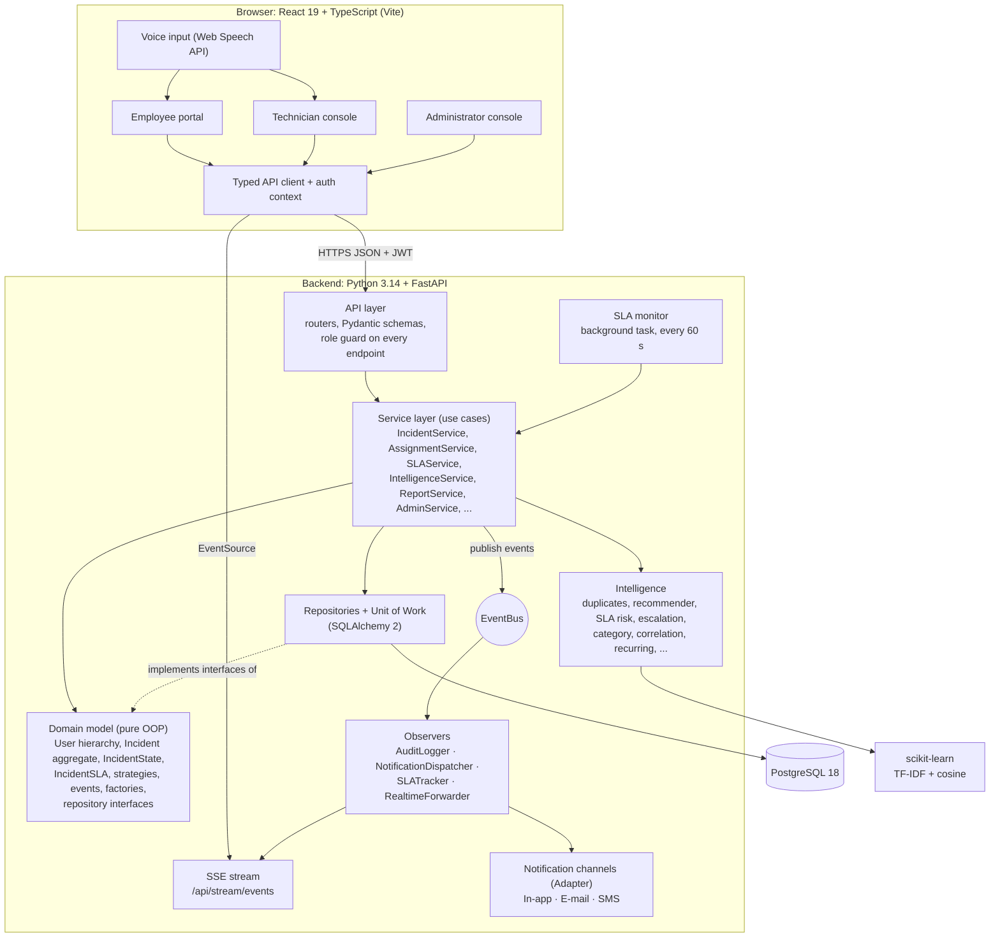

### 3.2 Components

| Layer | Package | Responsibility |
|---|---|---|
| Presentation | `frontend/src` | One interface per role; typed API client; live updates; voice input |
| API | `app/api` | HTTP routes, request / response schemas, role guards, error envelope, CSV export, SSE |
| Services | `app/services` | Use cases: one transaction per call, orchestrating domain objects, repositories and events |
| Domain | `app/domain` | Business rules: entities, value objects, the State machine, strategies, events, factories, exceptions, repository interfaces |
| Intelligence | `app/intelligence` | The intelligent features; scikit-learn is used only behind `TextSimilarity` |
| Observers | `app/observers` | React to domain events: audit, notifications, SLA records, live push |
| Notifications | `app/notifications` | Channel adapters wrapping simulated providers |
| Persistence | `app/repositories` | ORM models, mappers between ORM rows and domain objects, SQL and in-memory repositories |
| Workers | `app/workers` | The SLA monitor loop |
| Core | `app/core` | Configuration, JWT and Argon2, dependency wiring, error mapping |

### 3.3 How a request flows (Workflow 1: report an incident)

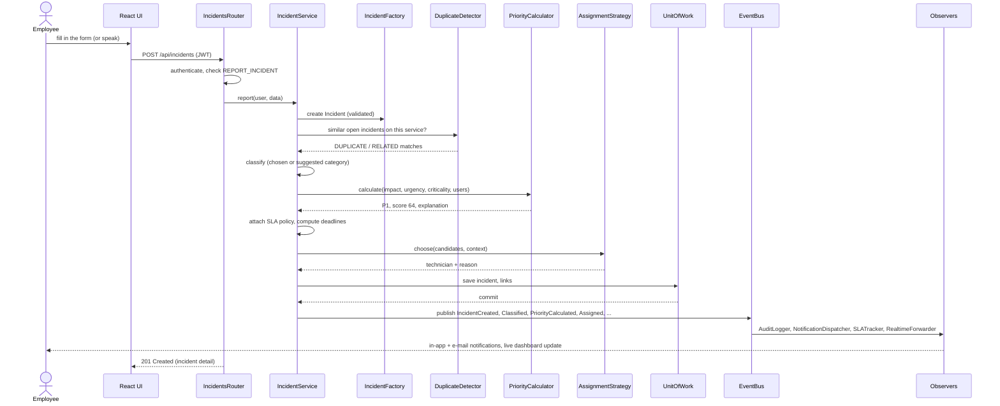

### 3.4 Why this architecture

- **Testability:** the domain and services are tested with in-memory repositories in milliseconds, without a database.
- **Replaceability:** the database, the text-similarity library and the notification providers are all behind interfaces.
- **Clarity for an OOP course:** the business rules are plain classes that can be read and explained on their own.
- **Right size:** a modular monolith gives the benefits of separation without the operational cost of microservices,
  and its module boundaries are the obvious places to split later (Section 16).

### 3.5 Workflow 2: investigate, SLA monitored, resolved, user notified

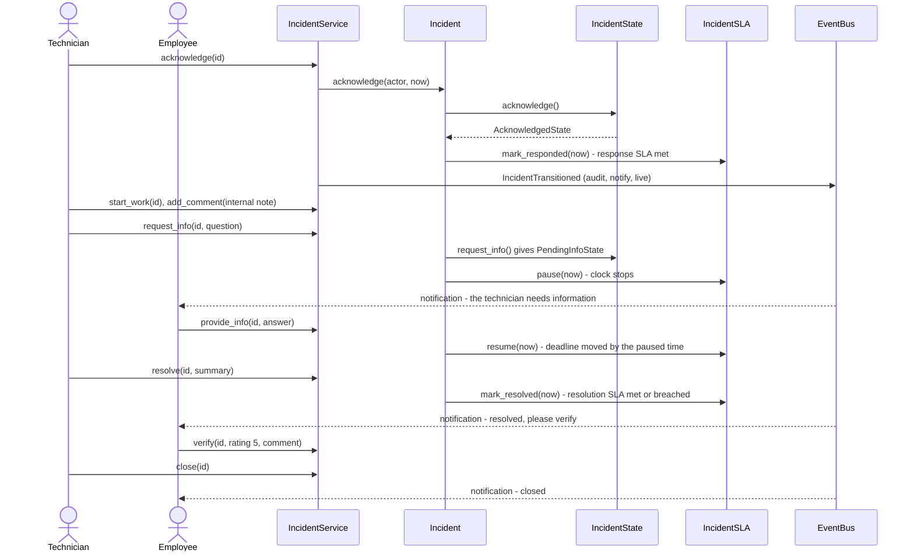

Every arrow into `Incident` goes through its current `IncidentState`, so an action that is not allowed in that state
(for example resolving an incident that was never acknowledged) raises `InvalidStateTransitionError` before anything
changes.

### 3.6 Workflow 3: multiple reports, duplicates, correlation and escalation

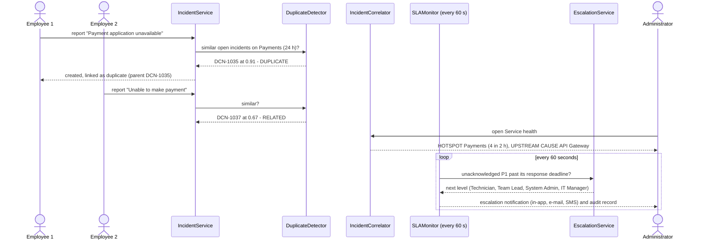

### 3.7 Background processing and real-time updates

**The SLA monitor** (`workers/sla_monitor.py`) is an asyncio task started with the application. Every 60 seconds it
opens one Unit of Work and, for every open incident:

1. asks the incident's `IncidentSLA` to `evaluate(now)`, which returns findings: a **warning** when 75 % of the active
   target has elapsed, a **breach** when the deadline passes (each reported once);
2. raises `SLAWarningRaised` / `SLAViolated` events; the `SLATracker` observer records each violation once (also
   enforced by a unique constraint) and the `NotificationDispatcher` alerts the assignee and administrators;
3. asks the `EscalationPolicy` whether an unacknowledged P1 (or P2, if enabled) has reached the next level, and walks
   the chain **one level per run**, so every level is audited and notified even after downtime.

Administrators can run the same check immediately with **Run SLA check now**.

**Live updates** use Server-Sent Events. The `RealtimeForwarder` observer queues a small message for each incident event,
and the Unit of Work sends it **only after the transaction commits** (`after_commit`), so a browser never shows a change
that was rolled back. The `EventBroadcaster` delivers each message only to its audience: staff see everything, an
employee only events about their own incidents. Dashboards, queues, the incident page and the notification bell refresh
themselves; the browser reconnects automatically if the connection drops.

---

## 4. UML diagrams

### 4.1 Use case diagram

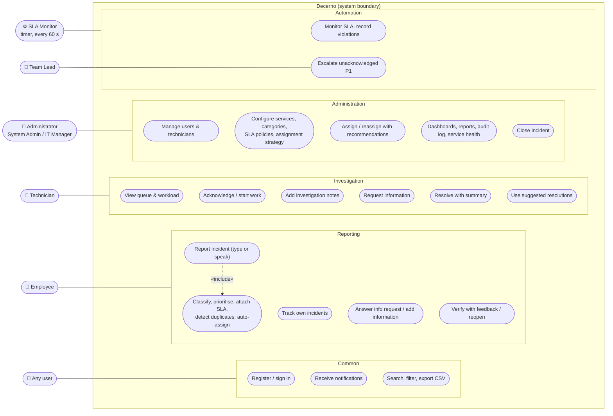

*Each actor is connected to the group of use cases it performs. Employee, Technician and Administrator are all users
(actor generalisation), so they share the Common use cases. A Team Lead is a Technician who also receives level-2
escalations. Administrators can also do everything a technician can, and technicians and administrators can close
incidents.*
### 4.2 Class diagram: users, incident aggregate and lifecycle

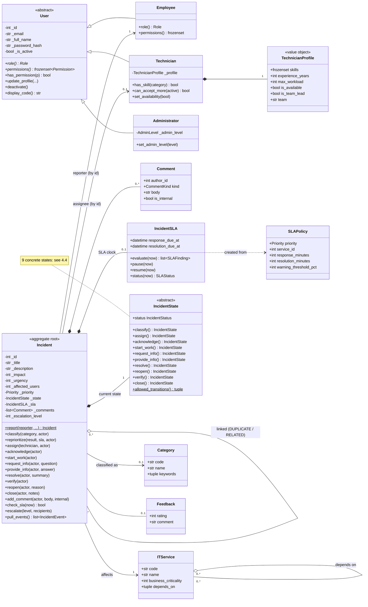

### 4.3 Class diagram: strategies, events, notifications, persistence

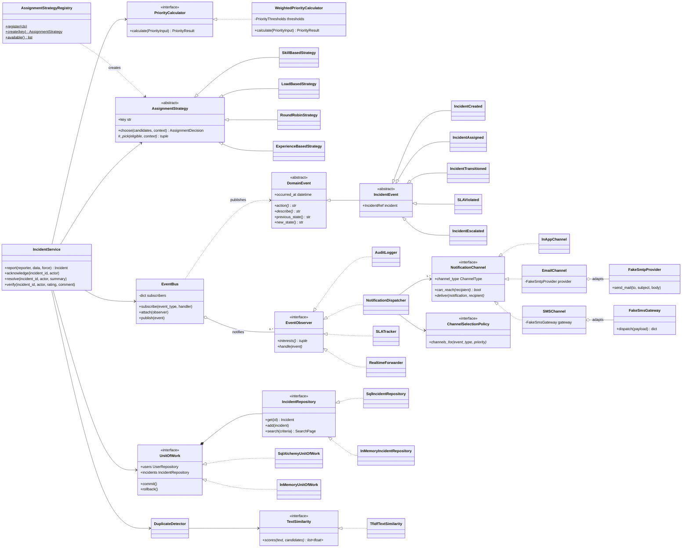

*Method lists show the main public operations; the full code is in `backend/app`. `*` = abstract, `$` = class-level.*

### 4.4 Lifecycle: State pattern classes and state diagram

Each concrete state overrides only the transitions it allows and returns the next state; every other method falls
through to the base class, which raises `InvalidStateTransitionError`.

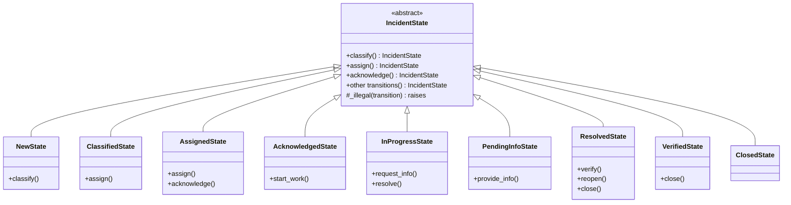

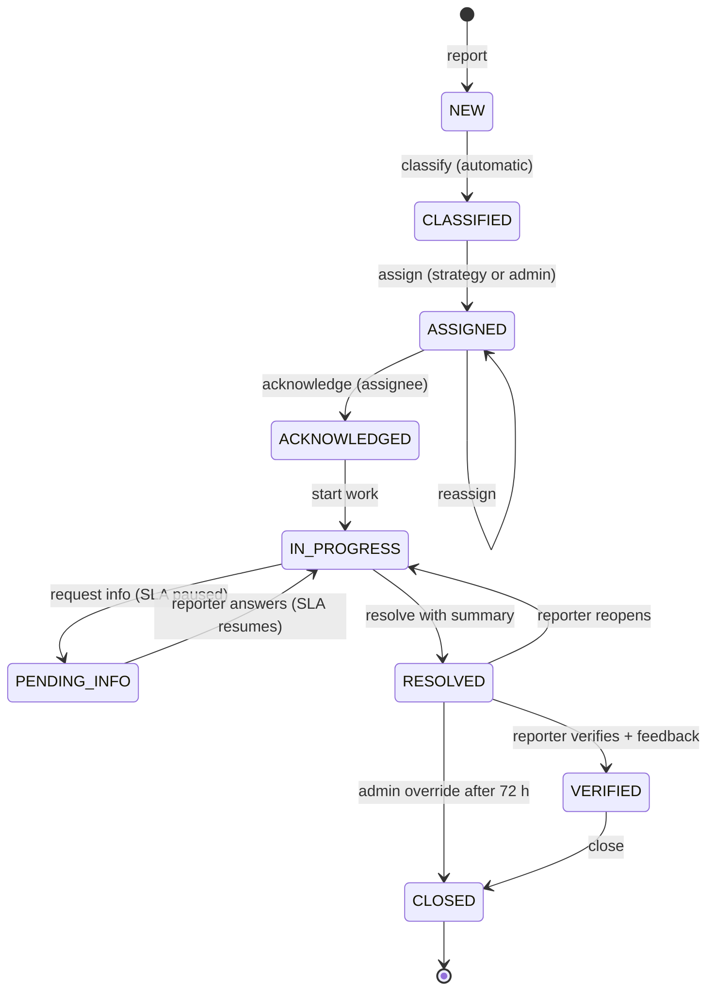

Any other move, for example NEW → CLOSED, raises `InvalidStateTransitionError` (HTTP 409).

---

## 5. Object-oriented design

### 5.1 OOP principles and where they are used

| Principle | Where | Why it matters here |
|---|---|---|
| **Encapsulation** | `Incident`, `User`, `IncidentSLA` keep their state in private attributes exposed through read-only properties. State changes only through intention-revealing methods (`incident.acknowledge(actor)`), which validate the actor and the transition. | No code can set `status = CLOSED` directly, so the lifecycle rules cannot be bypassed. |
| **Abstraction** | `PriorityCalculator`, `AssignmentStrategy`, `NotificationChannel`, `TextSimilarity`, `UnitOfWork`, the repository interfaces. Services work with these, never with concrete classes. | The service layer reads as business logic: "calculate priority, choose a technician, notify". |
| **Inheritance** (only for true *is-a*) | `User` → `Employee` / `Technician` / `Administrator`; `IncidentState` → 9 states; `DomainEvent` → 16 event types (13 of them `IncidentEvent`s); `ITSMError` → 25 exceptions. | Team lead and IT manager are **not** subclasses: they differ in data (a flag, a level), not behaviour, so they are attributes. |
| **Polymorphism** | `user.permissions()` differs per role; `state.resolve()` either returns the next state or raises; each `AssignmentStrategy._pick()` and `NotificationChannel.send()` differs; the event bus delivers by event class. | Callers never check types with `if role == ...`; adding a role or a state does not change them. |
| **Interfaces** | Abstract base classes and `Protocol`s define contracts: `EventObserver.handle`, `NotificationChannel.send`, `PasswordHasher`, `TokenService`, `Clock`. | Tests replace the clock, the database and the providers with fakes. |
| **Composition** | An `Incident` owns its `IncidentState`, `IncidentSLA` and `Comment`s; a `Technician` owns its `TechnicianProfile`; `EmailChannel` wraps a provider; the `ServiceContainer` composes services from parts. | Parts have no life of their own outside the owner, and behaviour is assembled instead of inherited. |
| **Association / aggregation** | `Incident` refers to its reporter, technician, service and category by id (association); incidents link to similar incidents (many-to-many aggregation); services aggregate their dependencies; the `EventBus` aggregates observers. | Objects in different aggregates stay independent and can be loaded separately. |
| **Exception handling** | A custom hierarchy rooted at `ITSMError`, each with a stable code and HTTP status (Section 12). | Every spec exception case has its own type and a consistent error response. |
| **Collections** | `frozenset` for skills and permissions (fast membership, immutable); `dict` registries for strategies, states and channels (O(1) lookup by key); `tuple` for immutable value lists; `defaultdict` grouping in the correlator and recurring-problem detector; a union-find (disjoint set) for clustering. | Each structure is chosen for the operation it supports. |

### 5.2 Design patterns (7 implemented; the spec asks for 2)

| Pattern | Classes | Problem it solves |
|---|---|---|
| **Strategy** | `PriorityCalculator` / `WeightedPriorityCalculator`; `AssignmentStrategy` with `SkillBased`, `LoadBased`, `RoundRobin`, `ExperienceBased`; `ChannelSelectionPolicy` | The algorithm for priority, assignment or channel choice can change (even at runtime, for assignment) without touching the code that uses it. |
| **State** | `IncidentState` and its 9 subclasses (`domain/lifecycle.py`) | Each state lists only the transitions it allows; anything else falls through to the base class, which raises. No large `if/else` on status. |
| **Observer** | `EventBus`, `EventObserver`; `AuditLogger`, `NotificationDispatcher`, `SLATracker`, `RealtimeForwarder` | The incident does not know who is interested in its changes. Adding a new reaction (for example a webhook) is one new observer. |
| **Factory** | `IncidentFactory`, `UserFactory`, `NotificationFactory`, `AssignmentStrategyRegistry.create` | Object creation with validation in one place; `UserFactory` returns the right `User` subclass for a role. |
| **Repository + Unit of Work** | Interfaces in `domain/repositories.py`; `Sql*Repository` and `InMemory*Repository`; `SqlAlchemyUnitOfWork` | Business code never sees SQL; one transaction per use case; tests run with no database. |
| **Adapter** | `EmailChannel` adapts `FakeSmtpProvider.send_mail(...)`, `SMSChannel` adapts `FakeSmsGateway.push(...)` to `NotificationChannel.send(...)` | Providers with incompatible APIs fit one interface; a real SMTP or SMS service can replace the fake one. |
| **Template Method** | `AssignmentStrategy.choose()` filters eligible technicians and raises if none, then calls the abstract `_pick()` | The common rules (availability, workload cap) are written once; each strategy only decides among eligible candidates. |

A **registry with a class decorator** (`@AssignmentStrategyRegistry.register`) makes the Open/Closed principle concrete:
a new strategy is one new class, with no change to the service, the API or the UI (the UI lists strategies from the API).

### 5.3 SOLID in practice

- **Single responsibility:** `Incident` enforces incident rules; `AuditLogger` only writes audit records;
  `TfidfTextSimilarity` only computes similarity.
- **Open/closed:** new categories are data (their keywords drive the suggestion immediately), new strategies and channels
  are new classes. Examples with code are in [`OPEN_CLOSED_EXAMPLES.md`](OPEN_CLOSED_EXAMPLES.md).
- **Liskov substitution:** any `IncidentRepository` (SQL or in-memory) and any `AssignmentStrategy` can replace another;
  the same tests pass with each.
- **Interface segregation:** each repository interface covers one aggregate; `PasswordHasher` and `TokenService` are
  separate small protocols.
- **Dependency inversion:** the domain defines the interfaces and the infrastructure implements them; the
  `ServiceContainer` wires concrete classes in one place.

### 5.4 Key classes and their responsibilities

| Class | Layer | Responsibility |
|---|---|---|
| `Incident` | domain | Aggregate root: validates its data, delegates every lifecycle move to its state, owns its SLA clock and comments, records domain events |
| `IncidentState` (+ 9 subclasses) | domain | Which transitions are allowed in each status |
| `IncidentSLA` | domain | Deadlines, warnings, breaches, pause / resume, elapsed percentage |
| `SLAPolicy`, `SLAPolicyResolver` | domain | Targets per priority; service-specific policy first, then default, else `MissingSLAConfigurationError` |
| `User` → `Employee`, `Technician`, `Administrator` | domain | Identity, validation and role-specific permissions (polymorphic `permissions()`) |
| `WeightedPriorityCalculator` | domain | The priority formula and its explanation text |
| `AssignmentStrategy` (4 subclasses) + registry | domain | Choosing a technician; switchable at runtime |
| `DefaultChannelSelectionPolicy` | domain | Which channels (in-app, e-mail, SMS) an event uses |
| `EventBus`, `DomainEvent` (16 types) | domain | Publishing what happened, decoupled from who reacts |
| `IncidentFactory`, `UserFactory`, `NotificationFactory` | domain | Validated creation in one place |
| `IncidentService` | service | Every incident use case in one transaction: report, assign, transitions, comments, feedback |
| `AssignmentService`, `SLAService`, `EscalationService` | service | Strategy selection and workload; SLA checks; escalation steps |
| `IntelligenceService` | service | Front door to the intelligent features |
| `ReportService`, `SearchService`, `AdminService`, `AuthService` | service | Dashboards; 11-criterion search; configuration with validation; registration and login |
| `AuditLogger`, `NotificationDispatcher`, `SLATracker`, `RealtimeForwarder` | observers | Reactions to events |
| `EmailChannel`, `SMSChannel`, `InAppChannel` | notifications | Adapters over the (simulated) providers |
| `SqlAlchemyUnitOfWork`, `Sql*Repository`, mappers | persistence | Transactions and translation between domain objects and rows |
| `TfidfTextSimilarity` | intelligence | The only class that imports scikit-learn |

### 5.5 How the design absorbed changes

Three changes made late in the project show the design at work:

| Change | What was touched | What was not |
|---|---|---|
| The SLA clock must pause while waiting for the reporter | `IncidentSLA` (pause / resume), two columns, the `PendingInfoState` transitions | services, API, other features |
| Reporter ratings should influence recommendations | `TechnicianRecommender` (one new weighted factor) | assignment strategies, incidents, UI apart from the reason text |
| Incident numbers should be `DCN-1001` | one constant and two methods on `Incident` | storage (numbers are derived from ids), search logic, every other class |

---

## 6. Intelligent features

The spec asks for at least two. Decerno has thirteen, all rule-based or classic information retrieval, and all
**explainable**: every result carries the reason it was produced. Formulas, thresholds and their calibration are in
[`docs/ALGORITHMS.md`](ALGORITHMS.md).

| # | Feature (spec letter) | How it works | Where users see it |
|---|---|---|---|
| 1 | **Priority determination** | min(64, I × U × C × users factor), P1 ≥ 32 > P2 ≥ 16 > P3 ≥ 6 > P4, with the formula shown | Incident page, audit trail |
| 2 | **Duplicate / related detection** (A) | scikit-learn TF-IDF on character 3-5-grams + cosine similarity, open incidents on the same service in the last 24 h; ≥ 0.85 duplicate, ≥ 0.18 related | Report form (before submitting), incident page "Related incidents" |
| 3 | **Incident correlation** (B) | Service dependency graph: a **hotspot** is ≥ 3 incidents on one service in 2 h; an **upstream cause** is a dependency that also has recent incidents | Service health page (graph + findings) |
| 4 | **Automatic escalation** (C) | Level = min(4, 1 + ⌊overdue / response window⌋): Technician → Team Lead → System Admin → IT Manager; one level per monitor run, each audited and notified | Incident page, admin dashboard, notifications |
| 5 | **Smart technician recommendation** (D) | Weighted: skill 0.40, free capacity 0.20, experience 0.15, history on the service 0.10, reporter ratings 0.10, availability 0.05 (critical incidents favour experience) | Incident page for administrators, with reasons |
| 6 | **SLA risk detection** (E) | min(elapsed %, 150) × priority weight, + 15 if unassigned, + 10 if unacknowledged after half the response window → LOW / MEDIUM / HIGH / BREACHED | Dashboards "At risk" list |
| 7 | **Category suggestion** (F) | 0.6 × keyword score + 0.4 × TF-IDF similarity to resolved history per category; correct for 39 of 43 seed incidents | Report form, live while typing |
| 8 | **Suggested resolutions** (G) | Fixes from the most similar resolved incidents | Incident page for technicians |
| 9 | **Self-help: "Try this first"** | The same suggester run on the text the employee is typing | Report form |
| 10 | **Predicted resolution time** | Median working time (pauses excluded) of ≥ 3 comparable resolved incidents (category + priority, else priority) | Incident page ("typically resolved in about 1.5 h") |
| 11 | **Recurring problem detection** | Single-link clustering (union-find) of similar incidents on a service over 30 days: ≥ 3 incidents spanning ≥ 24 h | Service health page |
| 12 | **Impact / urgency hints** | Phrase rules ("all customers" → impact 4, "cannot pay" → urgency 4) with the matched phrase as the reason | Report form, with a "Use it" button |
| 13 | **Rating-aware recommendation** | Reporter feedback (1-5 stars) feeds the recommender; neutral below 2 ratings | Recommendation reasons ("rated 4.3/5 by 3 reporters") |

**Why character n-grams instead of word TF-IDF.** On the spec's own example, word TF-IDF scores
"Payment application unavailable" against "Payment transaction failing" at 0.05, because "payment", "payments" and "pay"
are different words. Character n-grams give 0.23-0.25 for related reports and 0.00-0.04 for unrelated ones, so the
0.18 threshold sits in a clear gap.

**Why rule-based rather than machine learning.** The spec allows either. Rules can be explained to a user and an
examiner, need no training data (a new organisation has none), and behave predictably. scikit-learn is used where
statistics clearly help (text similarity), and it is hidden behind the `TextSimilarity` interface, so a sentence-embedding
model could replace it with no other change.

### How each feature works (with worked examples)

**1. Priority.**
`base = impact × urgency × criticality` (each 1-4, so 1-64), multiplied by an affected-users factor (×1.0 up to 10
people, ×1.25 up to 100, ×1.5 above), capped at 64. Bands: P1 ≥ 32, P2 ≥ 16, P3 ≥ 6, else P4.

| Incident | I | U | C | Users | Calculation | Result |
|---|---|---|---|---|---|---|
| Payment application unavailable | 4 | 4 | 4 | 500 | 64 × 1.5 = 96, capped | **64 → P1** |
| Payment transaction failing | 4 | 3 | 4 | 200 | 48 × 1.5 = 72, capped | **64 → P1** |
| Mailbox slow for my team | 2 | 2 | 3 | 8 | 12 × 1.0 | **12 → P3** |
| Typo on the intranet wiki | 1 | 1 | 1 | 1 | 1 × 1.0 | **1 → P4** |

**2. Duplicate / related detection.** Candidates are open incidents on the same service from the last 24 hours. The
text `title. title. description` (the title counts twice) is compared with scikit-learn's `TfidfVectorizer` on
**character 3-5-grams** and cosine similarity. ≥ 0.85 is a duplicate, ≥ 0.18 is related; the top 5 are stored.

| "Payment application unavailable…" compared with | word TF-IDF | character 3-5-grams |
|---|---|---|
| "Payment transaction failing…" (related) | 0.05 | **0.23-0.25** |
| "Unable to make payment…" (related) | 0.09 | **0.22-0.24** |
| "Payment application is unavailable, users cannot…" (duplicate) | 1.00 | **0.93** |
| unrelated tickets (refund CSV, VPN, printer) | 0.00 | **0.00-0.04** |

Only a duplicate from the **same reporter within 30 minutes** is blocked (an accidental double submit); everyone
else's report is linked, never rejected.

**3. Correlation.** Over the service dependency graph: a **hotspot** is a service with ≥ 3 incidents reported in the
last 2 hours; an **upstream cause** is a service with recent incidents that depends on another service which also has
recent incidents. The graph is kept acyclic by a depth-first search whenever an administrator edits dependencies.

**4. Automatic escalation.** For an unacknowledged P1, `level = min(4, 1 + ⌊overdue / response window⌋)`. With a
5-minute response target, the levels fire at the deadline and 5, 10 and 15 minutes after it:

| Minutes after the response deadline | 0 | 5 | 10 | 15+ |
|---|---|---|---|---|
| Level | 1 Technician | 2 Team Lead | 3 System Administrator | 4 IT Manager |

**5. Smart technician recommendation.** `score = 100 × Σ weight × value`:

| Factor | Value in [0, 1] | Weight (P3/P4) | Weight (P1/P2) |
|---|---|---|---|
| Skill matches the category | 1 or 0 | 0.40 | 0.40 |
| Free capacity | 1 − active / max workload | 0.20 | 0.10 |
| Experience | min(years, 15) / 15 | 0.15 | 0.25 |
| History on this service | min(resolved here, 5) / 5 | 0.10 | 0.10 |
| Reporter ratings | (average − 1) / 4, neutral 0.5 below 2 ratings | 0.10 | 0.10 |
| Available and under the cap | 1 or 0 | 0.05 | 0.05 |

Critical incidents move weight from spreading load to experience. The top 3 come with reasons such as
"has NETWORK skill · 1/8 active incidents · 12 yrs experience · rated 4.3/5 by 3 reporters".

**6. SLA risk.** `score = min(elapsed %, 150) × priority weight (P1 1.3, P2 1.15, P3 1.0, P4 0.9)`, plus 15 if
unassigned and 10 if still unacknowledged after half the response window. BREACHED once the deadline has passed,
HIGH ≥ 90, MEDIUM ≥ 60, else LOW. Paused incidents are never at risk.

**7. Category suggestion.** `confidence = 0.6 × keyword score + 0.4 × history score`, where
`keyword score = hits / (hits + 1)` and the history score is the TF-IDF similarity to one document per category built
from its keywords and up to 30 recent resolved incidents. Shown at ≥ 0.12. Keywords are data, so a category an
administrator adds is suggested immediately. Correct for **39 of 43** seed incidents (91 %).

**8-9. Suggested resolutions and "Try this first".** The resolution summaries of the most similar resolved incidents,
for technicians on the incident page and for employees while they type.

**10. Predicted resolution time.** The median *working* time (paused time excluded) of at least 3 resolved incidents
with the same category and priority, falling back to the same priority. Shown as "typically resolved in about 1.5 h",
and as "taking longer than usual" once that time has passed.

**11. Recurring problems.** Within each service, incidents from the last 30 days are clustered by single-link
similarity (≥ 0.25) with a **union-find** structure. A cluster is reported when it has ≥ 3 incidents spread over
≥ 24 hours, so a one-off burst (an outage reported ten times in ten minutes) is not mistaken for a recurring problem.

**12. Impact / urgency hints.** Phrase rules per level, the highest level wins, and the matched phrase is the reason:
"all customers" → impact 4, "whole department" → 3, "a few colleagues" → 2, "only me" → 1; "cannot pay", "is down",
"outage" → urgency 4, "blocked", "deadline" → 3, "slow", "intermittent" → 2, "workaround", "no rush" → 1.

**13. Rating-aware recommendation.** See factor "Reporter ratings" above; feedback is collected when the reporter
verifies the fix.

### Explainability: the `Why Decerno decided` card

Every incident page has one card that lists each automatic decision with the reason the system recorded when it made it:

| Decision | Example of what the card shows |
|---|---|
| Category | `Auto-suggested, confidence 0.60` or `Chosen by the reporter` |
| Priority | `Impact 4 × urgency 3 × criticality 4 = 48; ×1.5 for 200 affected users → 64 → P1 (Critical)` |
| Deadlines | `Respond within 3 min · resolve within 20 min`: the P1 policy for Payments Platform, and any time paused while waiting for the reporter |
| Technician | `Skill-based: has APPLICATION skill and the lowest load among skilled (2 active)` |
| Similar reports | `When reported: possible duplicate of DCN-1038 (86% similar)`, plus reports linked later |
| Escalation | `Level 4 · IT Manager`: the chain it went through |

The card reads the incident and its audit trail; it does not recompute anything, so it always matches what actually happened. It is the reason for the name: *decernō*, `I decide`, and Decerno shows why.

### Innovation features

From the spec's innovation list: **real-time operational dashboard** (Server-Sent Events), **service dependency graph**,
**automated root-cause hints** (upstream cause, recurring problems), **predictive SLA violation detection**,
**incident similarity detection**, **AI-assisted classification**, **resolution recommendation**,
**automated escalation**, **analytics and visualisation**, **voice-based incident reporting**
(Web Speech API, on-device where the browser supports it, in the report form and every free-text box on the incident
page), and **CI/CD** with GitHub Actions.

---

## 7. User interface and experience

### 7.1 Design system

| Element | Choice | Why |
|---|---|---|
| Name and logo | **Decerno**: a white "D" holding a gold tick on indigo | "I decide" + "settled": the logo is the name's meaning |
| Typeface | **Domine** (serif) for all text, **IBM Plex Mono** for incident numbers and times | A calm, readable serif sets Decerno apart from typical dashboards; monospace makes `DCN-1038` and "3 min" line up |
| Colour | Deep **indigo** brand on cool neutrals, **gold** accent only in the logo | Red, amber and green are reserved for meaning (priority, SLA status, success), so colour never misleads |
| Themes | Light and dark, following the system or a manual toggle | All colours are design tokens defined once in `index.css`; components never use raw colours |
| Components | Hand-built (cards, badges, tables, timeline, charts in CSS / SVG) | No UI or chart library: a small bundle (~410 KB, ~120 KB compressed) and full control |
| Fonts offline | Self-hosted through `@fontsource` | The demo looks identical without internet |

### 7.2 One interface per role

| Role | Layout | Pages |
|---|---|---|
| Employee | Self-service **portal** with a top navigation bar | My incidents (with a "Needs your attention" box), Report an incident, Search (own incidents), Notifications |
| Technician | **Console** with a sidebar | My queue (sorted by deadline), All incidents, Notifications, Team workload, Service health |
| Administrator | **Console** with a sidebar | Dashboard, Incidents, SLA, Workload, Services, Users, Configuration, Audit log |
| Everyone | | Incident page (actions depend on role and state), sign-in, registration |

The incident page shows only the actions the current user may take in the current state; the list comes from the
backend (`available_actions`), so the UI and the business rules can never disagree.

### 7.3 Screens

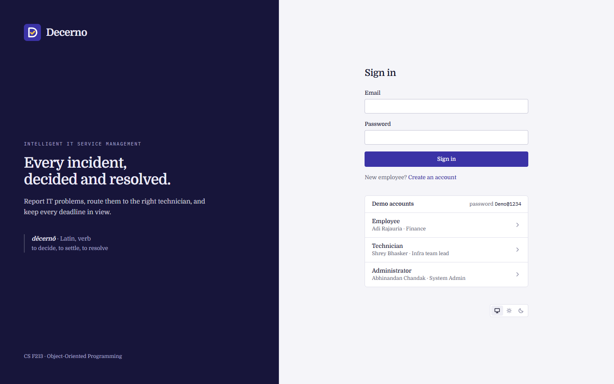

*Sign-in. One-click demo accounts for the three roles; the meaning of the name on the left.*

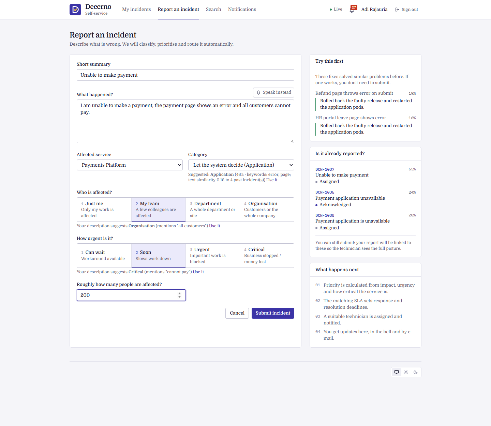

*Reporting an incident. While the employee types: "Try this first" fixes, similar open incidents (duplicate check),
the suggested category with its confidence, and impact / urgency hints with the phrase that triggered them. "Speak
instead" dictates the report.*

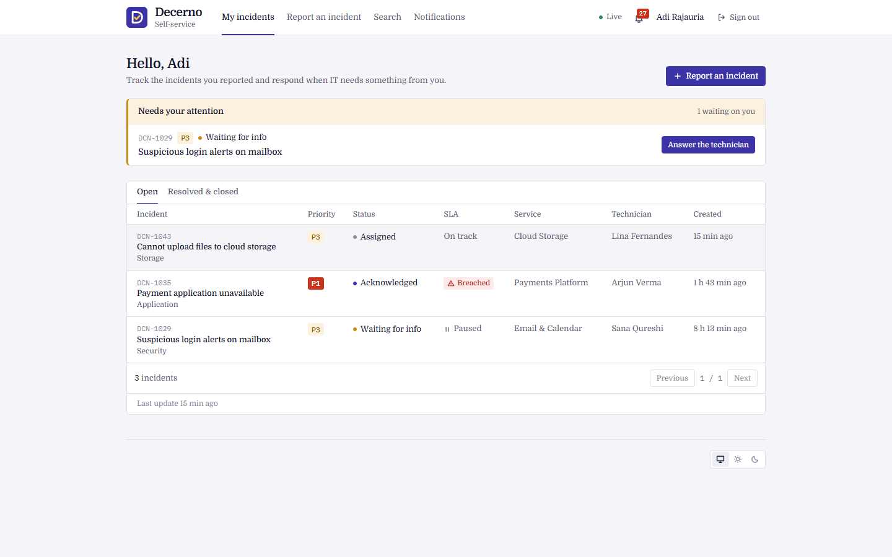

*Employee portal: what needs the employee's attention first, then their open incidents with SLA status.*

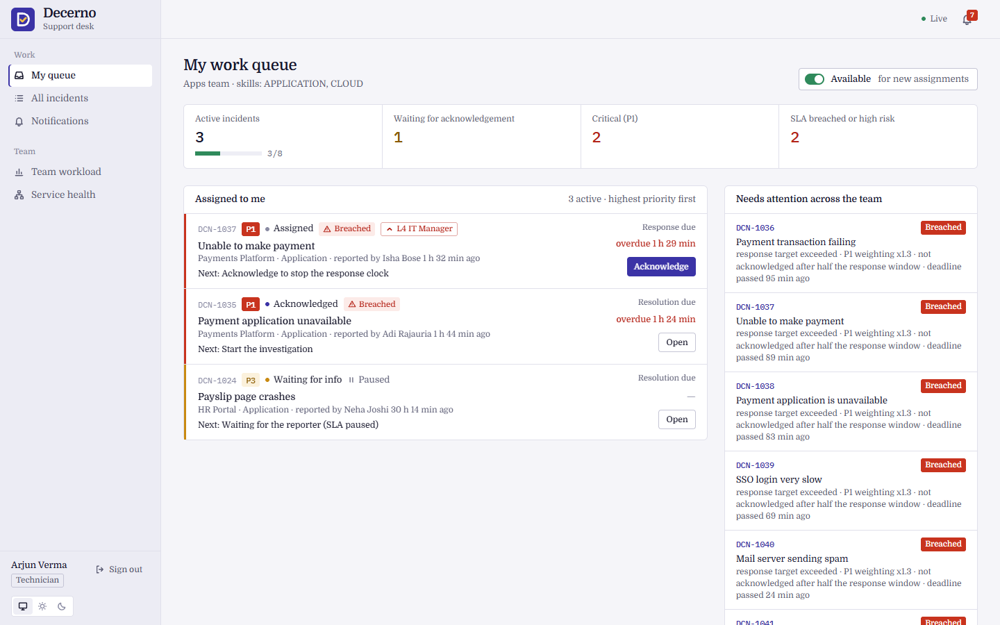

*Technician queue, sorted by deadline, with SLA countdowns.*

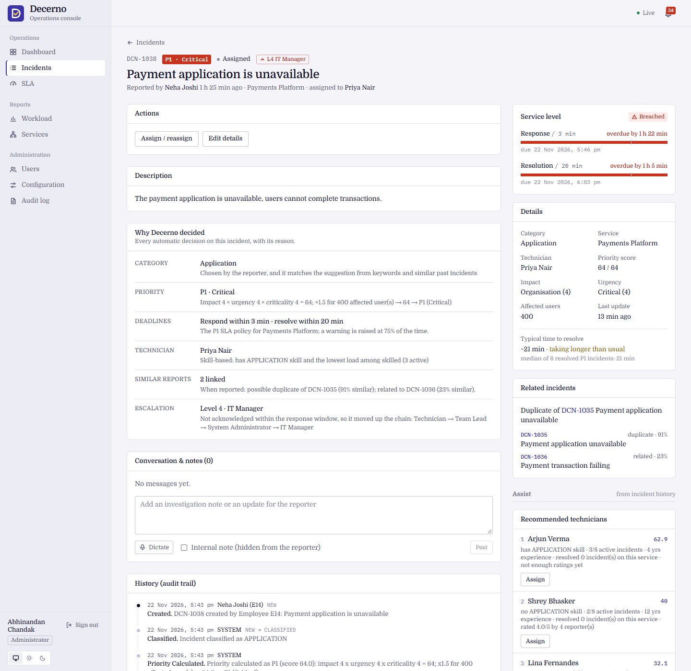

*Incident page: actions, description, **Why Decerno decided**, conversation, audit trail; SLA clocks, details,
predicted resolution time and related incidents on the right.*

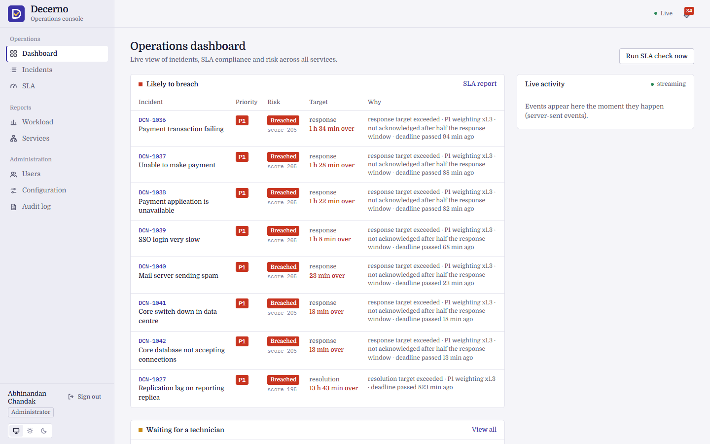

*Operations dashboard: incidents likely to breach with reasons, incidents waiting for a technician, live activity,
overview numbers and trends.*

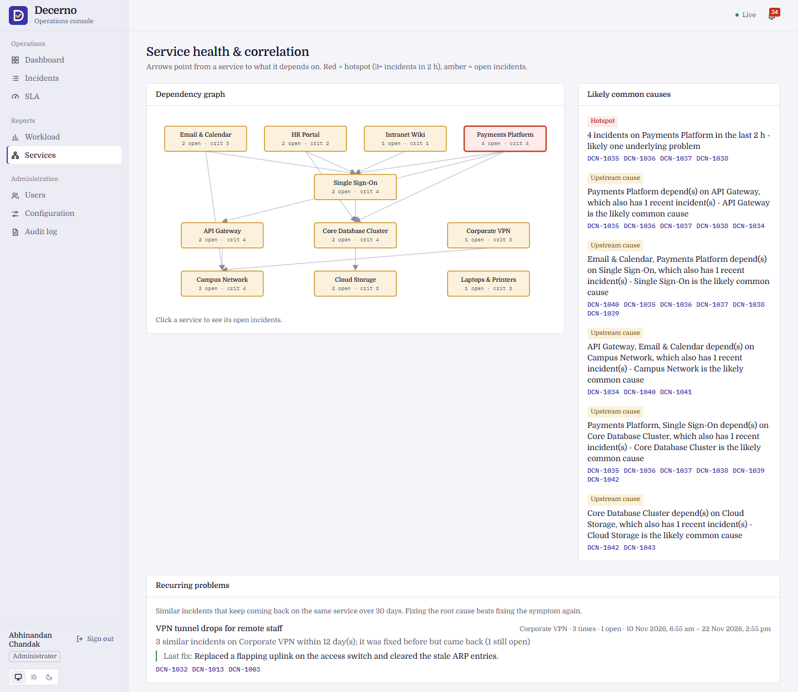

*Service health: dependency graph (red = hotspot), likely common causes, and recurring problems.*

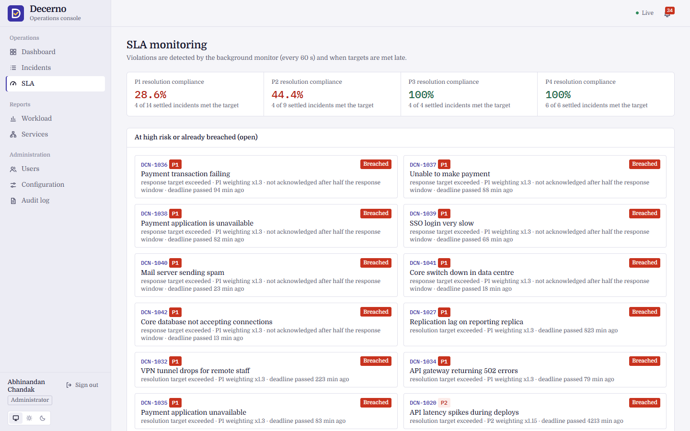

*SLA monitoring: compliance per priority, violations, CSV export.*

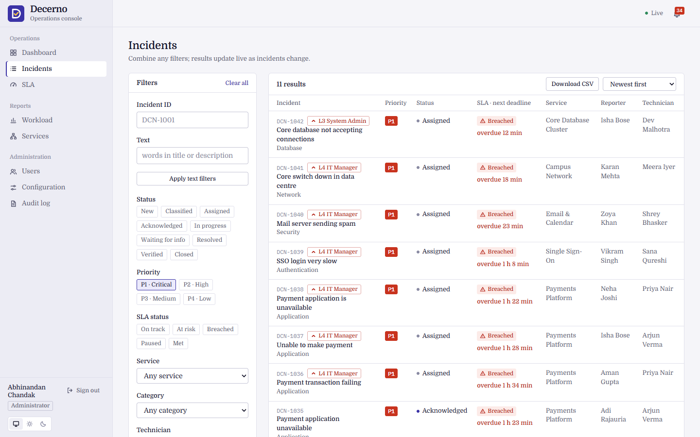

*Search with combinable filters (bookmarkable URL) and CSV export; escalation levels shown as badges.*

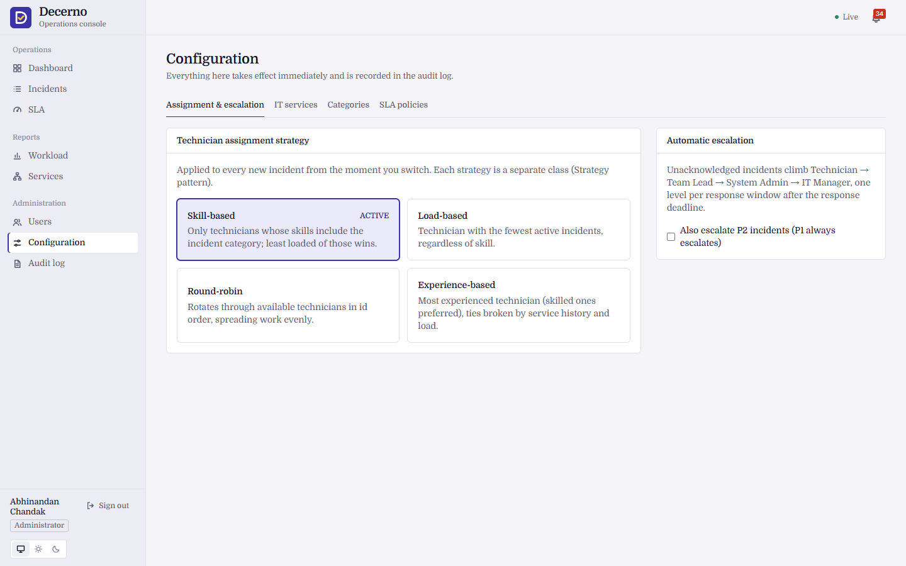

*Configuration: assignment strategy switched at runtime, escalation settings, services, categories, SLA policies.*

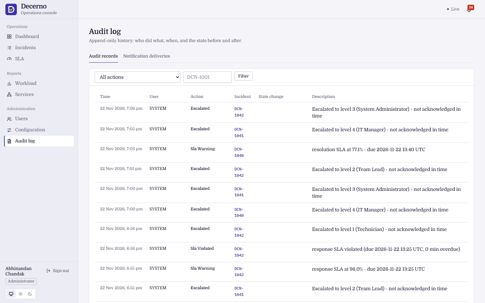

*Audit log: every action with actor, time and the state before and after; a second tab shows every notification
delivery.*

### 7.4 Usability and accessibility

- Every automatic decision comes with a plain-language reason (Section 6).
- Forms validate as you type and show server errors next to the relevant field.
- Semantic HTML, labelled form fields, `aria-label`s on icon buttons, visible keyboard focus, readable contrast in both
  themes.
- Responsive down to phone width: the employee navigation scrolls sideways, the staff sidebar becomes a drawer, and
  the SLA clocks move above the long history on small screens.
- Voice input on the report form and every free-text box of the incident page (Chrome / Edge), with on-device
  recognition where the browser offers it.

---

## 8. API design

### 8.1 Style

- **REST over JSON**, all under `/api`, documented automatically with **OpenAPI**: Swagger UI at `/docs`, ReDoc at
  `/redoc` (title "Decerno API").
- **Resources** are nouns (`/incidents`, `/admin/services`); **lifecycle actions are explicit sub-resources**
  (`POST /incidents/{id}/acknowledge`), because each one is a state transition that must be checked and audited. A
  generic `PATCH status=CLOSED` would make skipping states too easy.
- **Authentication:** `Authorization: Bearer <JWT>` on every call except health, login and registration.
- **Authorisation:** a permission guard on every route, then ownership rules in the domain.
- **Validation:** Pydantic models on every request body and query parameter.

### 8.2 Endpoints (73 operations)

| Area | Ops | Main endpoints |
|---|---|---|
| Health | 1 | `GET /health` (database check) |
| Auth | 3 | `POST /auth/register`, `POST /auth/login`, `GET /auth/me` |
| Incidents | 21 | `POST /incidents`, `GET /incidents` (11 filters, paging, sort), `GET /incidents/export.csv`, `GET` / `PATCH /incidents/{id}`; actions `assign`, `auto-assign`, `acknowledge`, `start`, `request-info`, `provide-info`, `comments`, `resolve`, `reopen`, `verify`, `close`, `feedback`; `audit`, `recommendations`, `resolution-estimate`, `suggested-resolutions` |
| Intelligence | 7 | `suggest-category`, `suggest-severity`, `check-duplicates`, `self-help` (while typing); `sla-risk`, `correlation`, `recurring` (staff) |
| Technicians | 3 | `GET /technicians/me/queue`, `PUT /technicians/me/availability`, `GET /technicians/workload` |
| Notifications | 4 | list, unread count, mark one / all read |
| Reports | 6 | `overview`, `technicians`, `services`, `sla`, `sla/violations.csv`, `trends` |
| Lookups | 3 | services, categories, technicians (for forms) |
| Admin | 24 | users (list, create, edit, activate, deactivate), technician profiles, services and their dependencies, categories, SLA policies (CRUD), assignment strategy, escalation settings, audit logs, notification log, `sla/check-now` |
| Real-time | 1 | `GET /stream/events` (Server-Sent Events) |

### 8.3 Example: reporting an incident

```http
POST /api/incidents
Authorization: Bearer eyJhbGciOi...
Content-Type: application/json

{ "title": "Unable to make payment",
  "description": "I am unable to make a payment, the payment page shows an error.",
  "service_id": 6, "impact": 4, "urgency": 4, "affected_users": 200, "category_id": null }
```

```json
201 Created (abbreviated)
{ "id": 44, "number": "DCN-1044", "status": "ASSIGNED", "priority": "P1", "priority_score": 64.0,
  "category": { "name": "Application" }, "technician": { "name": "Arjun Verma" },
  "sla": { "response_minutes": 3, "resolution_minutes": 20, "status": "ON_TRACK" },
  "links": [ { "number": "DCN-1037", "similarity": 0.67, "link_type": "RELATED" } ],
  "available_actions": ["comment", "update"] }
```

### 8.4 Errors

Every error uses one envelope, with a stable machine-readable code:

```json
409 Conflict
{ "error": { "code": "INVALID_STATE_TRANSITION",
             "message": "Cannot 'close (awaiting reporter verification)' an incident in state RESOLVED",
             "details": { "current_state": "RESOLVED", "action": "close (awaiting reporter verification)" } } }
```

| Status | Meaning |
|---|---|
| 401 | not signed in, bad or expired token (with `WWW-Authenticate: Bearer`) |
| 403 | signed in but not allowed (role or ownership) |
| 404 | incident, service, user, category or policy not found |
| 409 | invalid transition, duplicate incident, conflict, technician unavailable or over workload |
| 422 | invalid input, invalid incident, missing SLA configuration |
| 503 | database failure |

---

## 9. Technology stack

| Layer | Technology | Version | Used for |
|---|---|---|---|
| Language (backend) | Python | 3.14 | All backend code, fully type-annotated |
| Web framework | FastAPI | 0.163 | REST API, dependency injection, OpenAPI docs (73 operations) |
| Validation | Pydantic | 2.14 | Request / response schemas, settings |
| ORM / migrations | SQLAlchemy 2 (typed), Alembic | 2.1 | Persistence, schema migrations |
| Database | PostgreSQL | 18 | Production database; SQLite in memory for fast tests |
| DB driver | psycopg | 3.3 | PostgreSQL access |
| Authentication | PyJWT (HS256), argon2-cffi (Argon2id) | | Tokens, password hashing |
| Intelligence | scikit-learn | 1.9 | TF-IDF vectoriser, cosine similarity |
| Server | Uvicorn | | ASGI server with reload and graceful shutdown |
| Language (frontend) | TypeScript | 7.0 | Type-safe UI and API client |
| UI library | React | 19.3 | Component-based UI |
| Build tool | Vite | 8.3 | Dev server, `/api` proxy, production build |
| Styling | Tailwind CSS | 4.3 | Design tokens, responsive layout, dark mode |
| Fonts | Domine, IBM Plex Mono (`@fontsource`, self-hosted) | 5.3 | Typeface for all text; monospace for numbers and times |
| Routing | React Router | 8.5 | Role-based routes |
| Browser APIs | Web Speech API, EventSource (SSE) | | Voice input, live updates |
| Testing | pytest, httpx (FastAPI TestClient) | | 178 automated cases |
| CI | GitHub Actions | | Tests on SQLite and PostgreSQL 18, migration + seed, frontend build |
| Version control | Git, GitHub | | Feature branches, pull requests |

No chart or component libraries are used: charts are plain CSS and SVG, which keeps the bundle small and the code
readable.

---

## 10. Technology selection report

The spec asks nine questions. Each answer gives the reason, not just the choice.

### 10.1 Why this programming language? (Python 3.14 + TypeScript)

- **Python** has first-class OOP (classes, abstract base classes, multiple inheritance for mixins, properties,
  `Protocol` for structural interfaces, dataclasses for value objects) without the ceremony of Java, so the design
  patterns are visible in a few lines each.
- Modern Python is **statically checkable**: every function is type-annotated, and frozen dataclasses and `StrEnum`
  make values immutable and safe.
- It has the strongest ecosystem for the **intelligent features** (scikit-learn), which would be harder in most other
  languages.
- **TypeScript** on the frontend gives the same safety in the browser: the API client and all response types are
  typed, so a backend change that breaks the UI is caught at build time.

### 10.2 Why this frontend technology? (React 19 + Vite + Tailwind CSS)

- The spec requires **a different interface for each role**. React's component model lets the three role interfaces
  share building blocks (cards, tables, forms, the incident timeline) while composing different pages.
- React is itself compositional, which matches the OOP design of the backend.
- **Vite** gives near-instant reloads and proxies `/api` to the backend, so there are no CORS issues in development.
- **Tailwind CSS v4** keeps styling next to the markup and supports design tokens, dark mode and responsive layouts.
- Direct access to browser APIs we needed: **EventSource** for live updates, **Web Speech** for voice input.

### 10.3 Why this backend technology? (FastAPI)

- **Dependency injection** (`Depends`) is built in. The role guard on every endpoint is one line
  (`Depends(require(Permission.WORK_INCIDENTS))`), and services are injected rather than constructed in handlers.
- **Pydantic** validates every request at the boundary and produces clear 422 errors.
- **OpenAPI documentation** is generated automatically (`/docs`), which made frontend work and testing faster.
- FastAPI is **thin**: it does not impose an ORM or a project structure, so the domain could stay framework-free.
  Django, by contrast, pushes business logic into its models.
- It supports **streaming responses** for Server-Sent Events and background tasks for the SLA monitor.

### 10.4 Why this database? (PostgreSQL 18)

- Incidents, users, services, SLA policies, audit records and their relationships are **strongly relational**, with
  foreign keys, unique constraints ("one feedback per incident", "one policy per priority and service") and
  transactional updates (an incident change and its audit record commit together). A relational database enforces these
  rules itself.
- **ACID transactions** match the Unit of Work pattern: one use case, one transaction.
- **Indexes** on status, priority, service, technician and creation time keep the queue, search and dashboards fast.
- It is free, mature, and runs the same locally and in any cloud.
- The schema uses only **portable column types**, so the test suite also runs on SQLite in memory with no setup. CI
  runs it on both.

### 10.5 Why this architecture? (Layered / clean modular monolith)

- It puts the **domain model at the centre**, which is what an OOP project should demonstrate, and keeps it free of
  framework code so it can be tested and explained in isolation.
- **Dependencies point inward** (API → services → domain ← repositories), so the database, web framework or ML library
  could be replaced without changing business rules.
- A **monolith** is the right size for one team and one deployment; module boundaries (incidents, SLA, notifications,
  intelligence, reporting) are clean enough to split into services later.
- The **event bus** already makes the internal design event-driven: audit, notifications and live updates react to
  events instead of being called directly.

### 10.6 What alternatives did we consider?

| Decision | Alternatives | Why we did not choose them |
|---|---|---|
| Backend language | Java + Spring Boot | Strong OOP, but much more boilerplate; the patterns are harder to see; a weaker ML ecosystem |
| Backend framework | Django + DRF | Its "fat model" style mixes persistence with business rules; harder to keep a pure domain layer |
| Backend framework | Node.js + Express | Weaker typing on the server and no scikit-learn |
| Frontend | Angular, Vue | Angular is heavier for a small team; Vue was viable, but the team knew React better and React 19 has a larger ecosystem |
| Mobile | Flutter / React Native | The users are office staff at desks; a responsive web app reaches phones too without a second codebase |
| Database | MongoDB | Our data is relational with many constraints; a document store would push integrity checks into application code |
| Database | MySQL | Viable; PostgreSQL has better standards support and a stronger JSON type for skills and keywords |
| Architecture | Microservices | Network calls, distributed transactions and deployment overhead with no benefit at this scale |
| Real-time | WebSockets | Updates only flow server → client; SSE is simpler, works over plain HTTP and reconnects automatically |
| Intelligence | A large language model | Needs an external paid service and network, is not deterministic, and is hard to explain; rules + TF-IDF are explainable and free |
| Auth | Sessions + cookies | JWT keeps the API stateless; the trade-offs are documented in Section 13 |

### 10.7 Advantages and limitations of our stack

**Advantages**

- A clear, type-checked OOP domain; 178 tests that run in about 40 seconds.
- Automatic API documentation; automatic validation; one-line role guards.
- Explainable intelligence with a well-known library.
- Free, open-source, cross-platform; one command to run each side.
- CI on two databases catches database-specific bugs.

**Limitations**

- Python is slower than Java or Go per request. This is irrelevant at this scale, and the fix is horizontal scaling
  (Section 16).
- The SLA monitor and the live-update broadcaster run **inside the API process**, so running several API processes would
  need a shared broker and a separate worker (Section 16).
- E-mail and SMS are **simulated**.
- The token is stored in `localStorage` and passed to the SSE stream as a query parameter (Section 13).
- Voice input needs Chrome or Edge, and a network that allows the browser's speech service unless the browser has an
  on-device model.

### 10.8 How does our technology support object-oriented design?

- **Python ABCs and `Protocol`s** express interfaces (`AssignmentStrategy`, `NotificationChannel`, `UnitOfWork`), and
  `@abstractmethod` stops anyone from creating an incomplete implementation.
- **Properties and private attributes** give encapsulation; **frozen dataclasses** give immutable value objects
  (`TechnicianProfile`, `PriorityResult`, `SLAPolicy`).
- **Class decorators** implement the self-registering strategy registry (Open/Closed).
- **FastAPI's dependency injection** supplies abstractions to the API layer, so handlers depend on services, not on
  construction details.
- **SQLAlchemy** lets us keep ORM row classes separate from domain classes, with mappers in between, so persistence
  never leaks into the domain.
- **TypeScript interfaces** mirror the API contracts; React components compose like objects.

### 10.9 How would the system evolve if the number of users increased significantly?

See Section 16 for details. In short:

1. Run **several stateless API processes** behind a load balancer (JWT needs no server-side session).
2. Move the **SLA monitor** into its own worker with a database lock so only one instance runs, and move **live updates**
   to Redis pub/sub so every API process can push to its own clients.
3. Send notifications through a **message queue** (e.g. RabbitMQ), so slow providers never slow down a request.
4. Add **PostgreSQL read replicas** for dashboards and search, then **partition** the incidents and audit tables by month.
5. Replace per-request TF-IDF with a **vector index** (pgvector) of precomputed embeddings.
6. Split along existing module boundaries (notifications, intelligence, reporting) into separate services only where
   load requires it.

---

## 11. Database design

### 11.1 ER diagram

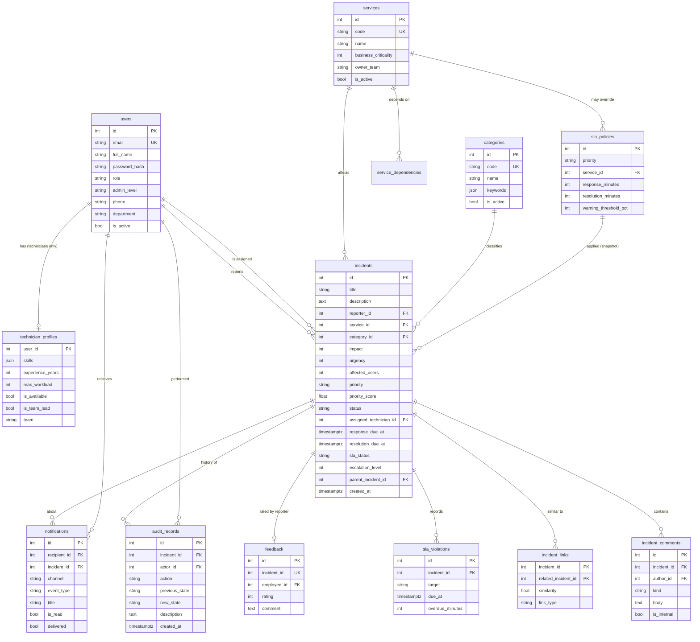

The full column list (including the SLA snapshot and pause columns) is in [`docs/ER.md`](ER.md); the schema source is
`backend/app/repositories/orm.py`, and migrations are in `backend/alembic/versions/`.

### 11.2 Schema (14 tables)

| Table | Purpose | Key columns |
|---|---|---|
| `users` | All accounts (single table for the inheritance hierarchy) | `email` unique, `role`, `admin_level`, `password_hash` (Argon2id) |
| `technician_profiles` | Technician-only data (1 : 0..1) | `skills` (JSON list of category codes), `max_workload`, `is_team_lead`, `team` |
| `services` | IT services | `code` unique, `business_criticality` 1-4 |
| `service_dependencies` | Directed dependency graph | (`service_id`, `depends_on_service_id`) |
| `categories` | Incident categories | `code` unique, `keywords` (JSON) drive suggestions |
| `sla_policies` | Targets per priority, optionally per service | unique (`priority`, `service_id`); `service_id` null = default |
| `incidents` | The incident aggregate, including its SLA clock | number = DCN- + (1000 + id), e.g. DCN-1035; SLA targets snapshotted; `sla_status` denormalised for filtering |
| `incident_comments` | Notes, info requests, replies | `kind`, `is_internal` |
| `incident_links` | Duplicate / related pairs | `similarity`, `link_type` |
| `audit_records` | Append-only history | `action`, `previous_state`, `new_state`, `description`, actor |
| `sla_violations` | Recorded breaches | unique (`incident_id`, `target`) |
| `notifications` | Every notification on every channel | `channel`, `delivered`, `delivery_error`, `is_read` |
| `feedback` | Reporter rating 1-5 and comment | `incident_id` unique |
| `system_settings` | Key-value settings | active strategy, round-robin cursor, P2 escalation flag |

### 11.3 Important relationships and constraints

| Rule | Enforced by |
|---|---|
| One account per e-mail | `users.email` unique |
| A technician has exactly one profile | `technician_profiles.user_id` is both primary and foreign key |
| One SLA policy per (priority, service) | unique constraint `uq_sla_priority_service` |
| Each SLA target violated at most once per incident | unique `uq_violation_incident_target` + `SLATracker` check |
| One feedback per incident | `feedback.incident_id` unique |
| Dependency graph is acyclic | depth-first search in `AdminService` before saving |
| Fast queue, search and dashboards | indexes on (`status`, `priority`), (`service_id`, `created_at`), `sla_status`, `assigned_technician_id`, `reporter_id`, `created_at`; notifications (`recipient_id`, `is_read`) |

**Design notes.** The domain model and the table model are separate classes with mappers between them, so the domain
stays free of SQLAlchemy. The SLA clock is stored inline in `incidents` because it has no identity of its own
(composition). Policy targets are copied onto the incident when applied, so editing a policy never silently moves an
existing deadline.

### 11.4 Sample data

`python -m scripts.seed --reset` replays two weeks of history **through the real services** (so all rules, audit
records and notifications are genuine):

| Data | Count | Notes |
|---|---|---|
| Users | 18 | 3 administrators (2 System Admins, 1 IT Manager), 8 technicians in 4 teams (3 team leads), 7 employees |
| Services | 11 | criticality 1-4, with dependencies (e.g. Payments → API Gateway → Campus Network) |
| Categories | 9 | the spec's nine, each with keywords |
| SLA policies | 7 | the spec's 4 defaults + 3 service overrides |
| Incidents | 43 | every lifecycle state except the transient NEW |
| SLA violations | 25 | response and resolution |
| Links | 5 | the spec's three payment reports + a true duplicate |
| Escalations | 6 | P1s at different levels |

Example rows:

| Number | Title | Reporter | Service | Priority | Status | Technician |
|---|---|---|---|---|---|---|
| DCN-1035 | Payment application unavailable | Adi Rajauria | Payments Platform | P1 | ACKNOWLEDGED | Arjun Verma |
| DCN-1036 | Payment transaction failing | Aman Gupta | Payments Platform | P1 | ASSIGNED | Priya Nair |
| DCN-1037 | Unable to make payment | Isha Bose | Payments Platform | P1 | ASSIGNED | Arjun Verma |
| DCN-1038 | Payment application is unavailable (duplicate of DCN-1035) | Neha Joshi | Payments Platform | P1 | ASSIGNED | Priya Nair |
| DCN-1003, 1013, 1032 | VPN tunnel drops for remote staff (3 times in 12 days) | several | Corporate VPN | P2 / P3 | recurring problem | Infra team |

All demo accounts use the password `Demo@1234` (for example `abhinandan@decerno.demo`, `shrey@decerno.demo`, `adi@decerno.demo`).

---

## 12. Exception and error handling

Every exceptional situation in the spec has its own exception class. All derive from `ITSMError`, which carries a stable
machine-readable code; one handler maps them to HTTP responses in a consistent envelope
`{"error": {"code", "message", "details"}}`. Unexpected errors return a generic 500 and are logged, never shown with a
stack trace.

| Spec case | Exception | HTTP |
|---|---|---|
| Invalid login | `InvalidCredentialsError` (same message for unknown e-mail and wrong password) | 401 |
| Invalid / expired token | `InvalidTokenError` | 401 |
| Unauthorised operation | `UnauthorizedOperationError` | 403 |
| Invalid incident | `InvalidIncidentError` (e.g. too-short title, retired service, no category could be suggested) | 422 |
| Invalid user input | `InvalidInputError` (+ Pydantic validation) | 422 |
| Invalid state transition | `InvalidStateTransitionError(current_state, action)` | 409 |
| Technician unavailable | `TechnicianUnavailableError` (incident stays CLASSIFIED for an admin) | 409 |
| Technician workload exceeded | `TechnicianWorkloadExceededError` | 409 |
| Service not found | `ServiceNotFoundError` (also incident, user, category, policy) | 404 |
| Missing SLA configuration | `MissingSLAConfigurationError` (nothing is saved) | 422 |
| Duplicate incident | `DuplicateIncidentError` with the matching incidents; resubmit with `force=true` | 409 |
| Database failure | `PersistenceError` wrapping SQLAlchemy errors | 503 |
| Network failure | `NotificationDeliveryError`: recorded on the notification (`delivered=false`); the incident change still commits (502 only if raised directly) | — |
| Duplicate e-mail, feedback twice | `EmailAlreadyRegisteredError`, `FeedbackAlreadySubmittedError` | 409 |

The frontend shows these messages next to the relevant field or action (for example, "Could not suggest a category
from the description; please choose one" appears on the Category field).

---

## 13. Security

| Requirement | Implementation |
|---|---|
| **Authentication** | JWT (HS256, PyJWT), 60-minute tokens; signature, expiry, subject and role are required; a token stops working if the account is deactivated or its role changes |
| **Password protection** | Argon2id (salted, memory-hard); 8-128 characters with at least one letter and one digit; hashes never leave the server |
| **Role-based authorisation** | Two layers: a guard on every endpoint (`Depends(require(Permission.X))`), and domain rules on every operation (only the assignee resolves, only the reporter verifies, employees see only their own incidents, internal notes hidden from employees) |
| **Input validation** | Pydantic at the boundary, re-validated in domain constructors (defence in depth); all SQL through bound parameters; search text escaped |
| **Secure API access** | CORS limited to the frontend origin; only the `Authorization` and `Content-Type` headers allowed; no stack traces in errors |
| **Protection against unauthorised operations** | 403 with `UnauthorizedOperationError`; tested per role and per endpoint (TC-35, TC-94) |
| **Secrets** | JWT secret and database URL in `backend/.env` (not in Git); the app refuses to start with a secret shorter than 32 characters |
| **No account enumeration** | Same error and same hashing cost for unknown e-mails, wrong passwords and deactivated accounts |
| **CSV / formula injection** | Exported cells starting with `= + - @`, tab or CR get a leading apostrophe |
| **Auditability** | Every change recorded append-only with actor and time |
| **Voice privacy** | On-device recognition where available; otherwise audio goes to the browser vendor's speech service, never to our server; only after the user clicks and grants microphone permission |

**Documented trade-offs** (acceptable for this project, with the production alternative):
the token is kept in `localStorage` (use an httpOnly SameSite cookie plus CSRF token in production); the SSE stream takes
the token as a query parameter because `EventSource` cannot send headers (use a short-lived stream ticket); there are no
refresh tokens or login rate limiting (add per-IP and per-account limits and lockout).

---

## 14. Testing

### 14.1 Strategy

| Level | Folder | What it covers | Database |
|---|---|---|---|
| Unit | `tests/unit` | Domain rules: priority, lifecycle, SLA clock, strategies, factories, events, adapters, every intelligent feature | none |
| Service | `tests/services` | Use cases end to end with in-memory repositories and a controllable clock | none |
| API / integration | `tests/api` | HTTP routes, role guards, error mapping, SQL repositories, the seed script, CSV export | SQLite in memory, **and** PostgreSQL 18 |

- **178 test cases** (108 test functions, some parametrised), about 40 seconds.
- A **fixed, controllable clock** makes every time-based rule (SLA warnings, breaches, escalation levels) testable at
  exact boundaries.
- **GitHub Actions CI** runs the suite on SQLite and on a PostgreSQL 18 container, runs the migrations and the seed on a
  fresh database, and builds the frontend, on every push and pull request.
- A manual **end-to-end rehearsal** of the three demo workflows against the running system passed before recording.

The full table of **106 documented test cases** (ID, description, input, expected result, type) is in
[`docs/TEST_CASES.md`](TEST_CASES.md). The spec asks for at least 15; a representative selection covering every type:

| ID | Description | Input | Expected | Type |
|---|---|---|---|---|
| TC-01 | Priority score = impact × urgency × criticality | I=2, U=2, C=2, 1 user | score 8, P3, explanation shows the formula | Normal |
| TC-02 | Priority band boundaries | scores 64, 32, 31.99, 16, 15.99, 6, 5.99, 1 | P1, P1, P2, P2, P3, P3, P4, P4 | Boundary |
| TC-03 | Affected-users factor boundaries | 1, 10, 11, 100, 101 users | ×1.0, ×1.0, ×1.25, ×1.25, ×1.5 | Boundary |
| TC-06 | Invalid priority input | impact 0, urgency 5, 0 users | `InvalidInputError` | Invalid input |
| TC-08 | NEW → CLOSED rejected | `NewState.close()` | `InvalidStateTransitionError(NEW, close)` | Exception / state |
| TC-09 | Every state allows exactly its designed transitions | 9 states × 10 actions | allowed set matches the design, all others raise | State |
| TC-12 | Missing SLA configuration | only a P1 policy, ask for P2 | `MissingSLAConfigurationError` | Exception |
| TC-15 | Warning at exactly 75 % | 20-min target at 14:59 / 15:00 | none / WARNING, status AT_RISK | Boundary |
| TC-20 | Skill-based assignment without a skilled technician | HARDWARE incident | `TechnicianUnavailableError` | Exception |
| TC-24 | Workload limit excludes a technician | 3 active, max 3 | `TechnicianUnavailableError` | Boundary |
| TC-25 | New strategy registered with no other change | new class registered in a test | usable immediately (Open/Closed) | Business rule |
| TC-33 | Report the payment outage | PAY, I=4, U=4, 50 users | P1 (64), deadlines +5 / +30 min, assigned, audited, technician notified on 3 channels | Normal |
| TC-34 | Complete lifecycle | ack, start, note, request info, reply, resolve, verify (4★), close | CLOSED; 10 audited state changes in order; feedback stored | Normal / state |
| TC-35 | Role and ownership rules | employee acknowledges; non-assignee acknowledges; other employee views | 403 × 4 | Authorization |
| TC-37 | Closing an unverified resolution | technician close; admin at +1 h; admin at +73 h | rejected, rejected, CLOSED with override note | Business rule |
| TC-41 | Background SLA monitor | +4 min, +6 min, run twice | 1 warning, then 1 violation recorded once; admins notified | Business rule |
| TC-43 | Network failure during notification | SMTP provider down | incident still ASSIGNED; e-mail `delivered=false`; in-app delivered | Exception |
| TC-45 | Runtime strategy switch | employee sets LOAD; admin sets LOAD | 403; next incident goes to lowest-load technician | Authorization / rule |
| TC-52 | Invalid login | wrong password; unknown e-mail | same `InvalidCredentialsError` | Exception / auth |
| TC-54 | Token integrity and expiry | other key; tampered token; +60 min | `InvalidTokenError` each time | Authorization |
| TC-64 | Database failure | two services with the same code | `PersistenceError` → 503 | Exception |
| TC-65 | SLA clock pauses while waiting for the reporter | pause at +10, resume at +40 | no findings while paused; resolution deadline moves to +60 | Business rule |
| TC-69 | Similarity on the spec's payment examples | "Payment application unavailable" vs 2 related + 1 unrelated | related ≥ 0.18, unrelated < 0.1 | Normal / boundary |
| TC-75 | Escalation level boundaries | 0 / 0.02 / 4.9 / 5 / 10 / 15 / 99 min after due | 0, 1, 1, 2, 3, 4, 4 | Boundary |
| TC-79 | Same-reporter duplicate blocked unless forced | same report twice in 5 min; then `force` | `DuplicateIncidentError`; forced one created and linked | Exception / rule |
| TC-86 | Invalid search criteria | page 0, page size 101, 201-char text, from > to | `InvalidInputError` | Invalid input |
| TC-94 | Role guards over HTTP (11 cases) | each role × admin, reports, intelligence, queue | 403 or 200 exactly as designed | Authorization |
| TC-106 | CSV export | admin, P1 filter, employee; title `=HYPERLINK(...)` | all rows; only P1; only own; cell escaped as text | Normal / security |
| TC-107 | Decerno incident numbers | "DCN-1005", "dcn1005", "1005", "INC1005", "DCN-" | 5, 5, 5, then rejected | Normal / invalid input |


### 14.2 Bugs found and fixed during development

| Bug | Found by | Fix |
|---|---|---|
| Word-level TF-IDF missed the spec's related payment reports | Calibration test (TC-69) | Switched to character 3-5-grams and recalibrated the threshold |
| SLA clock kept running while waiting for the reporter | Review of assumption 7 | Pause / resume in `IncidentSLA`, persisted (TC-65 to TC-68) |
| Backend reload hung while live-update streams were open | Manual testing | Graceful-shutdown timeout in the run scripts |
| Voice input reported "needs internet" while online | User testing | Clear cause-specific messages; on-device recognition where available |

### 14.3 End-to-end rehearsal against the running system

Before recording, the three demo workflows were run end to end against the real backend, database and frontend with
every role (about 60 checks):

| Area | Result |
|---|---|
| Time-sensitive views right after seeding | P1 incidents at escalation levels 2, 3 and 4; payments hotspot; upstream causes; the VPN recurring problem; 18 incidents at SLA risk |
| Workflow 1 | P1 calculated, category suggested, SLA attached, auto-assigned, technician notified, estimate shown |
| Workflow 2 | acknowledge, start, internal note, request info (clock paused), reply, resolve, verify with rating, close; full audit trail; employee blocked from technician actions |
| Workflow 3 | the spec's wording linked as duplicate and related; the same report twice blocked; hotspot detected |
| Report form helpers | self-help tips, impact / urgency hints, category suggestion, duplicate preview |
| Search, CSV, permissions | every filter; both CSV exports; employees export only their own incidents; role guards |

Two findings became demo guidance rather than code changes: reports must be worded naturally for duplicate detection
to link them (as in the spec's examples), and "Payment transaction failing" alone gives no confident category, so the
form asks the reporter to choose one (the invalid-incident exception case, handled as designed).

### 14.4 Continuous integration

| Job | Steps |
|---|---|
| Backend (SQLite) | install pinned requirements, run all 178 tests on an in-memory database |
| Backend (PostgreSQL 18) | start a PostgreSQL container, run the migrations and the seed on a fresh database, run all tests against `itsm_test` |
| Frontend | `npm ci`, type-check, production build |

---

## 15. Development process

### 15.1 Version control and reviews

- Git and GitHub from the first day. Each feature or fix was built on its **own branch** and merged through a
  **pull request** with a summary and a test plan (21 pull requests), with CI required to pass first.
- Commits are small and describe the change and the reason.
- After the feature work was merged, final polishing was committed directly on `main`.

### 15.2 Quality practices

| Practice | How |
|---|---|
| Static typing | Every Python function is type-annotated; the frontend is strict TypeScript; API types mirror the backend schemas |
| Domain first | Business rules were written and unit-tested before any route or page used them |
| Tests with every change | New behaviour came with tests (178 cases now); bugs got a test that reproduced them first |
| Migrations | Every schema change is an Alembic migration; CI runs them on a fresh PostgreSQL database |
| Realistic data | The seed replays two weeks of history through the real services, so demo data obeys every rule |
| Documentation | Plan, assumptions (99, numbered), algorithms, ER design, security, setup, test cases, Open/Closed examples, this report and the demo script, all in `docs/` |

### 15.3 Size of the code base

| Part | Files | Lines |
|---|---|---|
| Backend application (`backend/app`) | 88 | ~7,500 |
| of which the domain model | 23 | ~2,450 |
| Backend tests | 18 | ~1,800 |
| Frontend (`frontend/src`) | 42 | ~5,200 |
| Documentation (`docs`) | 10 | ~2,300 |

---

## 16. Scalability and future evolution

The current deployment is deliberately a **single process**: the API, the 60-second SLA monitor and the live-update
broadcaster share one Uvicorn process. That is correct for a department-sized organisation and a demo. The design is
ready for the following steps, which change infrastructure classes but not the domain:

| Growth | Bottleneck | Evolution | What changes in the code |
|---|---|---|---|
| More concurrent users | One API process | Several API processes behind a load balancer; JWT is stateless, so any process can serve any request | Nothing in the domain or services |
| Several API processes | The SLA monitor would run once per process; live updates only reach clients of the same process | Run the monitor as a separate worker with a PostgreSQL advisory lock; publish live events through Redis pub/sub | `workers/`, `realtime/broadcaster.py` |
| Many notifications | Slow e-mail / SMS providers in the request | A message queue (RabbitMQ / Redis Streams) between `NotificationDispatcher` and the channels; retries with back-off | A queue-backed `NotificationChannel` adapter |
| Heavy dashboards | Aggregate queries on the main database | Read replicas; materialised views refreshed every minute; caching | Report repository only |
| Millions of incidents | Table size | Partition `incidents`, `audit_records` and `notifications` by month; archive closed incidents | Migrations only |
| Similarity at scale | TF-IDF computed per request over candidates | Precompute embeddings into a vector index (pgvector) | A new `TextSimilarity` implementation |
| Several organisations | Single tenant | Add a tenant id to aggregates and row-level security | Repositories and schema |
| Global use | Latency | Containerise (Docker), deploy to Kubernetes or a managed platform, CDN for the frontend | Deployment only |

Because every one of these sits behind an existing interface (`UnitOfWork`, `NotificationChannel`, `TextSimilarity`,
`EventObserver`), the business rules and their 178 tests stay unchanged. This is the practical payoff of the
object-oriented design.

Other planned improvements: real e-mail / SMS providers, business-hours SLA calendars, OAuth single sign-on, login rate
limiting, refresh tokens in httpOnly cookies, and a knowledge base built from resolved incidents.

---

## 17. Known limitations

| Limitation | Effect | Possible next step |
|---|---|---|
| E-mail and SMS are simulated | Messages are recorded, not sent | Real providers behind the existing adapters |
| Single process (SLA monitor and live updates inside the API) | Running several API processes would duplicate the monitor and split live updates | Separate worker with a database lock, Redis pub/sub (Section 16) |
| SLA clocks run 24 × 7 | No business hours or holidays | A calendar per SLA policy |
| Thresholds (similarity 0.18 / 0.85, risk levels) were calibrated on our own data | May need tuning for another organisation | Make them settings; recalibrate on real history |
| Token in `localStorage`, SSE token in the query string | Exposed if an XSS bug existed; may appear in server logs | httpOnly cookie, single-use stream ticket |
| No login rate limiting or refresh tokens | Sign in again after 60 minutes; brute force slowed only by Argon2 | Rate limiting, lockout, refresh tokens |
| Voice input depends on the browser | Chrome / Edge only; may need the vendor's speech service | An on-premise speech-to-text service behind the same hook |
| Seed data is relative to "now" | Some demo views (hotspot, escalation levels) fade within minutes to an hour | Reseed shortly before a demo |

---

## 18. Team and responsibilities

| Member | Primary responsibility | Also contributed to |
|---|---|---|
| **[Member 1 name]** | **[e.g. Frontend, UI/UX, role interfaces, voice input]** | [ ] |
| **[Member 2 name]** | **[e.g. Domain model, OOP design patterns, backend services and APIs]** | [ ] |
| **[Member 3 name]** | **[e.g. Database, intelligent features, testing and CI]** | [ ] |

Every member understands the overall system; each explains their module in the demo video.

---

## 19. Conclusion

Decerno covers the complete incident lifecycle the spec describes, and every MVP requirement, user role, search
criterion, exception case and security point (Appendix A). Beyond the minimum, it has thirteen explainable intelligent
features, seven design patterns, real-time dashboards, a service dependency graph, voice input and CI on two databases.

The main lesson is the one the project set out to show: **object-oriented design makes change cheap.** Switching the
assignment strategy at runtime, adding a category without code, pausing the SLA clock, adding rating-aware
recommendations and recurring-problem detection late in the project were all local changes, because each concern
lives behind its own abstraction. The 178 tests, which stayed green through those changes, are the evidence.

---

## Appendix A: Spec coverage checklist

| Spec requirement | Status | Where |
|---|---|---|
| 3 user categories | ✅ Employee, Technician, Administrator (+ team lead, system admin, IT manager levels) | `domain/users.py` |
| Incident create / view / update / assign / resolve / close | ✅ | `services/incident_service.py`, incident page |
| Priority: impact, urgency, business criticality (+ affected users) | ✅ documented formula | `domain/strategies/priority.py`, Section 6 |
| ≥ 2 assignment strategies, switchable | ✅ 4, switchable at runtime | `domain/strategies/assignment.py` |
| SLA calculation, deadlines, violations, warnings, background monitoring | ✅ | `domain/sla.py`, `workers/sla_monitor.py` |
| ≥ 2 notification mechanisms | ✅ in-app, e-mail, SMS (+ live dashboard) | `notifications/` |
| Complete audit history with the spec's fields | ✅ | `observers/audit_logger.py` |
| ≥ 5 search criteria | ✅ 11 | `domain/search.py` |
| ≥ 2 intelligent features | ✅ 13 | `intelligence/` |
| Persistence | ✅ PostgreSQL 18 | `repositories/` |
| Lifecycle with illegal transitions prevented | ✅ State pattern | `domain/lifecycle.py` |
| New categories without major changes | ✅ data only | `OPEN_CLOSED_EXAMPLES.md` |
| Employee: register, report, track, add info, respond, view resolution, feedback | ✅ | employee portal |
| Technician: queue, acknowledge, investigate, notes, status, request info, resolve, workload | ✅ | technician console |
| Admin: users, technicians, services, SLA, categories, strategies, monitor, reports, audit, violations | ✅ | administrator console |
| Reports: overview, workload, service analysis | ✅ + SLA report, trends, service health | dashboards |
| All 12 exception cases | ✅ | Section 12 |
| Security minimum | ✅ | Section 13 |
| ≥ 2 design patterns | ✅ 7 | Section 5.2 |
| ≥ 15 test cases | ✅ 107 documented, 178 automated | Section 14 |
| Architecture, use case, class diagrams | ✅ | Sections 3-4 |
| Technology selection: 9 questions | ✅ | Section 10 |
| ER diagram, schema, relationships, sample data | ✅ | Section 11 |
| Innovation challenge | ✅ voice reporting, real-time dashboard, dependency graph, root-cause hints, predictive SLA, CI | Section 6 |
| Source code in version control | ✅ GitHub | repository link above |

## Appendix B: How to run

Prerequisites: Python 3.14, PostgreSQL 18, Node.js 26.

```bash
# 1. create the database (psql, as postgres):  CREATE DATABASE itsm;
# 2. configure: copy backend/.env.example to backend/.env, set ITSM_DATABASE_URL and ITSM_JWT_SECRET
# 3. run (two terminals)
./run_backend.sh        # Windows: .\run_backend.ps1   -> http://127.0.0.1:8000/docs
./run_frontend.sh       # Windows: .\run_frontend.ps1  -> http://127.0.0.1:5173
# 4. demo data
cd backend && .venv/bin/python -m scripts.seed --reset      # Windows: .venv\Scripts\python -m scripts.seed --reset
# 5. tests
cd backend && .venv/bin/pytest
```

Full instructions: [`README.md`](../README.md) and [`docs/SETUP.md`](SETUP.md).

## Appendix C: Demo accounts

All accounts use the password `Demo@1234`.

| Role | Account | Name | Notes |
|---|---|---|---|
| Administrator | `abhinandan@decerno.demo` | Abhinandan Chandak | System Admin (one-click on the sign-in page) |
| Administrator | `ops@decerno.demo` | Omar Siddiqui | System Admin |
| Administrator | `manager@decerno.demo` | Ravi Menon | IT Manager, last escalation level |
| Technician | `shrey@decerno.demo` | Shrey Bhasker | Infra team lead: NETWORK, SECURITY (one-click) |
| Technician | `priya@decerno.demo` | Priya Nair | Apps team lead: APPLICATION, SOFTWARE, DATABASE |
| Technician | `arjun@decerno.demo` | Arjun Verma | Apps: APPLICATION, CLOUD |
| Technician | `meera@`, `tom@`, `dev@`, `lina@`, `sana@decerno.demo` | | Infra, Platform and Identity teams |
| Employee | `adi@decerno.demo` | Adi Rajauria | Finance, reported the payment outage (one-click) |
| Employee | `aman@`, `neha@`, `vikram@`, `zoya@`, `karan@`, `isha@decerno.demo` | | Sales, HR, Operations, Marketing, Engineering, Customer Support |
